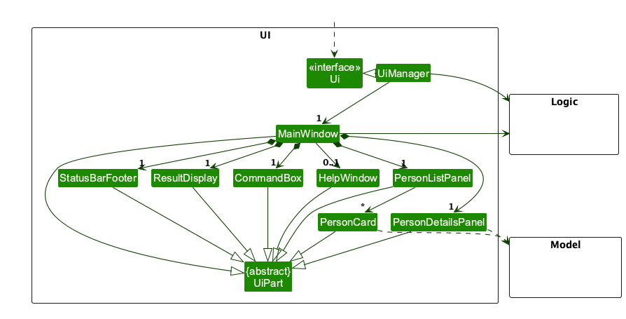
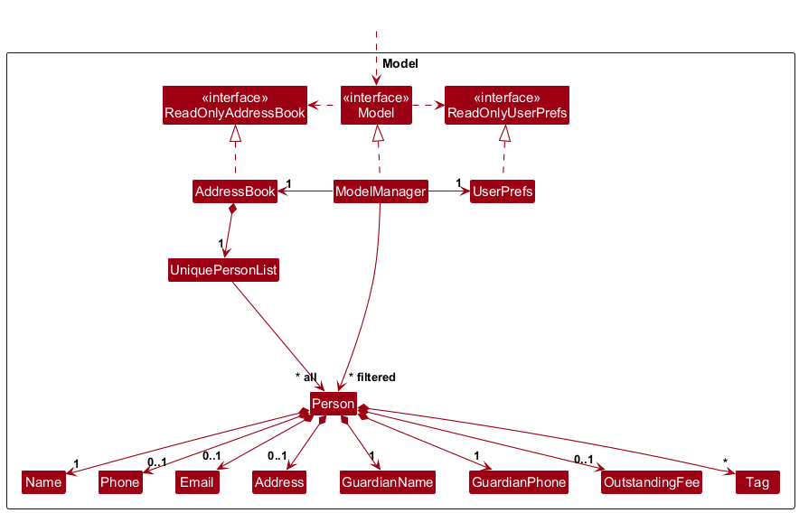
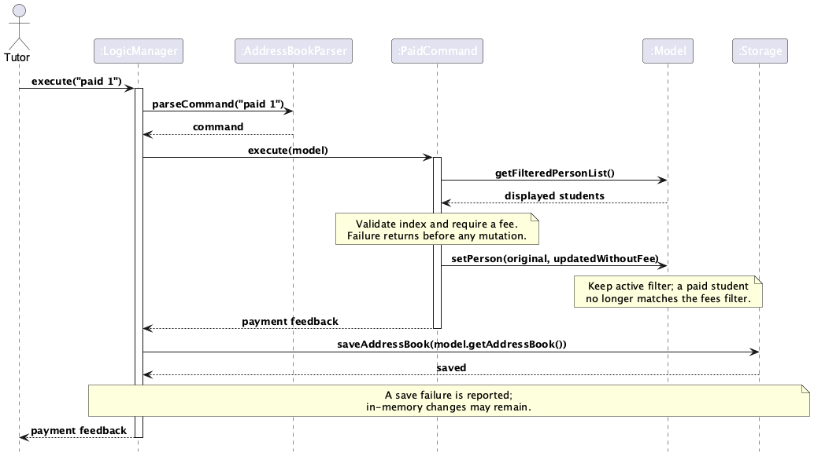

* Table of Contents
{:toc}

--------------------------------------------------------------------------------------------------------------------

## **Acknowledgements**

* _{List the sources of reused or adapted ideas, code, documentation, and third-party libraries here, with links to the originals.}_

--------------------------------------------------------------------------------------------------------------------

## **Setting up, getting started**

Refer to the guide [_Setting up and getting started_](SettingUp.md).

--------------------------------------------------------------------------------------------------------------------

## **Design**

:bulb: **Tip:** The `.puml` files used to create diagrams are in `docs/diagrams`. Refer to the [_PlantUML Tutorial_ at se-edu/guides](https://se-education.org/guides/tutorials/plantUml.html) to learn how to create and edit diagrams.

### Architecture

The ***Architecture Diagram*** given above explains the high-level design of the App.

The following provides a quick overview of the main components and their interactions.

**Main components of the architecture**

**`Main`** (consisting of classes [`Main`](https://github.com/AY2627S1-CS2103T-F09-2a/tp/tree/master/src/main/java/seedu/address/Main.java) and [`MainApp`](https://github.com/AY2627S1-CS2103T-F09-2a/tp/tree/master/src/main/java/seedu/address/MainApp.java)) is in charge of the app launch and shut down.
* At app launch, it initializes the other components in the correct sequence, and connects them up with each other.
* At shut down, it shuts down the other components and invokes cleanup methods where necessary.

The bulk of the app's work is done by the following four components:

* [**`UI`**](#ui-component): The UI of the App.
* [**`Logic`**](#logic-component): The command executor.
* [**`Model`**](#model-component): Holds the data of the App in memory.
* [**`Storage`**](#storage-component): Reads data from, and writes data to, the hard disk.

[**`Commons`**](#common-classes) represents a collection of classes used by multiple other components.

**How the architecture components interact with each other**

The *Sequence Diagram* below shows how the components interact with each other for the scenario where the user issues the command `delete 1`.

Each of the four main components (also shown in the diagram above),

* defines its *API* in an `interface` with the same name as the Component.
* provides its functionality through a concrete `{Component Name}Manager` class that implements the corresponding API interface.

For example, the `Logic` component defines its API in `Logic.java` and implements it in `LogicManager.java`. Other components interact with a component through its interface rather than its concrete class, preventing them from coupling to that component's implementation, as illustrated in the following partial class diagram.

The sections below give more details of each component.

### UI component

The **API** of this component is specified in [`Ui.java`](https://github.com/AY2627S1-CS2103T-F09-2a/tp/tree/master/src/main/java/seedu/address/ui/Ui.java)

The UI consists of a `MainWindow` and its parts, such as `CommandBox`, `ResultDisplay`, `PersonListPanel`, `PersonDetailsPanel`, and `StatusBarFooter`. All of these, including `MainWindow`, inherit from the abstract `UiPart` class, which captures common behavior among classes that represent visible GUI parts.

The `UI` component uses the JavaFX UI framework. The layouts of these UI parts are defined in matching `.fxml` files in `src/main/resources/view`. For example, [`MainWindow.fxml`](https://github.com/AY2627S1-CS2103T-F09-2a/tp/tree/master/src/main/resources/view/MainWindow.fxml) specifies the layout of [`MainWindow`](https://github.com/AY2627S1-CS2103T-F09-2a/tp/tree/master/src/main/java/seedu/address/ui/MainWindow.java).

The `UI` component,

* executes user commands using the `Logic` component.
* listens for changes to `Model` data so that the UI can be updated with the modified data.
* keeps a reference to the `Logic` component, because the `UI` relies on the `Logic` to execute commands.
* depends on some classes in the `Model` component because it displays `Person` objects from the model.

For `view INDEX`, `ViewCommand` reads the student at that index in the filtered list and returns the `Person` in `CommandResult` with a feedback message. It does not update the filter or model. `LogicManager` skips the storage write because `ViewCommand.shouldSaveAddressBook()` returns false. `MainWindow` selects that person in `PersonListPanel`; the list selection updates `PersonDetailsPanel`, which shows all stored fields. The details pane unwraps optional student contact fields and shows `Not provided` when a field is absent. It formats an outstanding fee as `S$` followed by two decimal places, or `None` when absent. A failed parse or out-of-range index produces no `CommandResult`, so the current selection and details remain unchanged.

Before executing a command, `MainWindow` remembers the selected student. After a successful command that does not explicitly select a student, it restores that selection by student identity if the student remains in the displayed list. This selects the current record after a fee change, so the details pane shows the updated amount. Otherwise it clears the selection and details pane. This also prevents a search from transferring the highlight to a different student at the same list index.

### Logic component

**API** : [`Logic.java`](https://github.com/AY2627S1-CS2103T-F09-2a/tp/tree/master/src/main/java/seedu/address/logic/Logic.java)

Here's a (partial) class diagram of the `Logic` component:

The sequence diagram below illustrates the interactions within the `Logic` component, taking `execute("delete 1")` API call as an example.

:information_source: **Note:** The lifeline for `DeleteCommandParser` should end at the destroy marker (X), but due to a limitation of PlantUML, it continues to the end of the diagram.

How the `Logic` component works:

1. When `Logic` is called upon to execute a command, the command is passed to an `AddressBookParser` object, which in turn creates a parser that matches the command (e.g., `DeleteCommandParser`) and uses it to parse the command.
1. This results in a `Command` object (more precisely, an object of one of its subclasses e.g., `DeleteCommand`) which is executed by the `LogicManager`.
1. The command can communicate with the `Model` when it is executed (e.g. to delete a person). 
   Note that although this is shown as a single step in the diagram above for simplicity, the code can require several interactions between the command object and the `Model` to complete the operation.
1. The result of the command execution is encapsulated as a `CommandResult` object which is returned from `Logic`.

Here are the other classes in `Logic` (omitted from the class diagram above) that are used for parsing a user command:

How the parsing works:
* When called upon to parse a user command, the `AddressBookParser` class creates an `XYZCommandParser` (`XYZ` is a placeholder for the specific command name, e.g., `AddCommandParser`). The parser uses the other classes shown above to parse the user command and create an `XYZCommand` object (e.g., `AddCommand`). The `AddressBookParser` returns that object as a `Command` object.
* All `XYZCommandParser` classes, such as `AddCommandParser` and `DeleteCommandParser`, implement the `Parser` interface so they can be treated similarly where appropriate, for example during testing.

### Model component
**API** : [`Model.java`](https://github.com/AY2627S1-CS2103T-F09-2a/tp/tree/master/src/main/java/seedu/address/model/Model.java)

The `Model` component,

* stores the address book data i.e., all `Person` objects (which are contained in a `UniquePersonList` object).
* stores the `Person` objects selected by the current filter, such as search results, in a separate _filtered_ list. It exposes this list as an unmodifiable `ObservableList<Person>` that the UI can observe and bind to, so the UI updates when the list changes.
* stores a `UserPrefs` object that represents the user’s preferences (currently, just the GUI settings). This is exposed to the outside as a `ReadOnlyUserPrefs` object.
* does not depend on any of the other three components (as the `Model` represents data entities of the domain, they should make sense on their own without depending on other components)

:information_source: **Note:** The alternative, arguably more object-oriented, design below keeps a unique list of tags in `AddressBook`, and each `Person` references tags from that list. This lets `AddressBook` maintain one `Tag` object per unique tag instead of each `Person` holding its own `Tag` objects. 

### Storage component

**API** : [`Storage.java`](https://github.com/AY2627S1-CS2103T-F09-2a/tp/tree/master/src/main/java/seedu/address/storage/Storage.java)

The `Storage` component,
* can save both address book data and user preference data in JSON format, and read them back into corresponding objects.
* is implemented by `StorageManager`, which delegates the actual JSON file access to `JsonAddressBookStorage` and `JsonUserPrefsStorage` (one class per data file).
* depends on some classes in the `Model` component (because the `Storage` component's job is to save/retrieve objects that belong to the `Model`)

### Common classes

Classes used by multiple components are in the `seedu.address.commons` package.

--------------------------------------------------------------------------------------------------------------------

## **Implementation**

This section describes some noteworthy details on how certain features are implemented.

### Fee summary and full-payment commands

The all-student fee total (`feesummary`) and full-payment recording (`paid`) extend the outstanding-fee feature described under the Logic and Model components. Both commands work on the immutable `OutstandingFee` value object, so no `Person`, `Model` or storage-format change was needed for v1.4.

#### Implementation

`FeeSummaryCommand` walks every person in the **complete** address book via `Model#getAddressBook()#getPersonList()` rather than the filtered list, keeps a running `BigDecimal` total and a count of students whose fee is present, and formats the result with `toPlainString()` so two decimal places are always shown. Iterating the unfiltered book is what makes the total independent of the current `find`/`fees` filter. The command also overrides `Command#shouldSaveAddressBook()` to return `false`, so `LogicManager` does not write to storage for a pure query. `FeeSummaryCommandParser` rejects any argument with `MESSAGE_INVALID_COMMAND_FORMAT`, which keeps `feesummary 1` from being silently accepted.

`PaidCommand` holds an `Index` that was validated by `ParserUtil#parseIndex` at parse time. During execution it (i) rejects an index outside the displayed list, (ii) looks up the target `Person` in that displayed list, and (iii) fails with a user-facing `CommandException` when the fee is absent (`Person#getOutstandingFee()` returns an `Optional`). Only after those checks does it construct a replacement `Person` with every other field copied verbatim — name, optional phone/email/address, guardian name and phone, and tags — and call `Model#setPerson(...)`. Because the `Person` is immutable, this copy-then-replace step is what preserves the fields the command does not touch, and because `setPerson` goes through the updated address book, the active filter and the GUI selection are refreshed by the usual `FilteredList`/`ObservableList` listeners.

The sequence of interactions for a successful payment is shown below.

The corresponding sources are `docs/diagrams/PaidSequenceDiagram.puml`, `FeeSummaryCommand`, `PaidCommand`, `FeeSummaryCommandParser`, `PaidCommandParser` and the `AddressBookParser` cases that register `feesummary` and `paid`.

#### Design considerations

* **Query vs mutation.** Only `paid` mutates and saves; `feesummary` opts out of saving so that a read-only command cannot report a save failure the user cannot act on.
* **Exact money arithmetic.** Amounts use `BigDecimal` rather than `double`, so totals of many two-decimal fees cannot drift by a cent, and the summary can legitimately exceed the S$99999.99 per-student cap.
* **Displayed index vs stored index.** Both commands act on the *displayed* list, matching `delete`, `edit`, `view` and `setoutstanding`. This keeps the mental model consistent, at the cost of the user needing to re-run `fees` after a payment because indexes shift.
* **Alternatives considered.** (a) Making `feesummary` respect the current filter was rejected because a filtered total is easy to misread as the amount still owed overall. (b) Making `paid` accept a partial amount was rejected for v1.4: it needs a payment-history model, which is a larger change than the iteration allows, so `setoutstanding INDEX 0` and `paid INDEX` both clear a whole fee. (c) Reusing `setoutstanding` with amount `0` instead of adding `paid` was considered, but a dedicated command gives clearer feedback (`S$AMOUNT` cleared) and cannot be confused with re-setting a fee.

### \[Proposed\] Undo/redo feature

#### Proposed Implementation

The proposed undo/redo mechanism is facilitated by `VersionedAddressBook`. It extends `AddressBook` with an undo/redo history, stored internally as an `addressBookStateList` and `currentStatePointer`. Additionally, it implements the following operations:

* `VersionedAddressBook#commit()` — Saves the current address book state in its history.
* `VersionedAddressBook#undo()` — Restores the previous address book state from its history.
* `VersionedAddressBook#redo()` — Restores a previously undone address book state from its history.

These operations are exposed in the `Model` interface as `Model#commitAddressBook()`, `Model#undoAddressBook()` and `Model#redoAddressBook()` respectively.

Given below is an example usage scenario and how the undo/redo mechanism behaves at each step.

Step 1. The user launches the application for the first time. The `VersionedAddressBook` will be initialized with the initial address book state, and the `currentStatePointer` pointing to that single address book state.

Step 2. The user executes `delete 5` command to delete the 5th person in the address book. The `delete` command calls `Model#commitAddressBook()`, causing the modified state of the address book after the `delete 5` command executes to be saved in the `addressBookStateList`, and the `currentStatePointer` is shifted to the newly inserted address book state.

Step 3. The user executes `add n/David …​` to add a new person. The `add` command also calls `Model#commitAddressBook()`, causing another modified address book state to be saved into the `addressBookStateList`.

:information_source: **Note:** If a command fails its execution, it will not call `Model#commitAddressBook()`, so the address book state will not be saved into the `addressBookStateList`.

Step 4. The user now decides that adding the person was a mistake, and decides to undo that action by executing the `undo` command. The `undo` command will call `Model#undoAddressBook()`, which will shift the `currentStatePointer` once to the left, pointing it to the previous address book state, and restores the address book to that state.

:information_source: **Note:** If the `currentStatePointer` is at index 0, pointing to the initial AddressBook state, then there are no previous AddressBook states to restore. The `undo` command uses `Model#canUndoAddressBook()` to check if this is the case. If so, it will return an error to the user rather
than attempting to perform the undo.

The following sequence diagram shows how an undo operation goes through the `Logic` component:

:information_source: **Note:** The lifeline for `UndoCommand` should end at the destroy marker (X), but due to a limitation of PlantUML, it continues to the end of the diagram.

Similarly, how an undo operation goes through the `Model` component is shown below:

The `redo` command does the opposite — it calls `Model#redoAddressBook()`, which shifts the `currentStatePointer` once to the right, pointing to the previously undone state, and restores the address book to that state.

:information_source: **Note:** If the `currentStatePointer` is at index `addressBookStateList.size() - 1`, pointing to the latest address book state, then there are no undone AddressBook states to restore. The `redo` command uses `Model#canRedoAddressBook()` to check if this is the case. If so, it will return an error to the user rather than attempting to perform the redo.

Step 5. The user then decides to execute the command `list`. Commands that do not modify the address book, such as `list`, will usually not call `Model#commitAddressBook()`, `Model#undoAddressBook()` or `Model#redoAddressBook()`. Thus, the `addressBookStateList` remains unchanged.

Step 6. The user executes `clear`, which calls `Model#commitAddressBook()`. Since the `currentStatePointer` is not pointing at the end of the `addressBookStateList`, all address book states after the `currentStatePointer` will be purged. Reason: It no longer makes sense to redo the `add n/David …​` command. This is the behavior that most modern desktop applications follow.

The following activity diagram summarizes what happens when a user executes a new command:

#### Design considerations:

**Aspect: How undo & redo execute:**

* **Alternative 1 (current choice):** Saves the entire address book.
  * Pros: Easy to implement.
  * Cons: May have performance issues in terms of memory usage.

* **Alternative 2:** Individual command knows how to undo/redo by
  itself.
  * Pros: Will use less memory (e.g. for `delete`, just save the person being deleted).
  * Cons: We must ensure that the implementation of each individual command is correct.

_{more aspects and alternatives to be added}_

### Command-specific help

`help` continues to open the help window. `HelpCommandParser` accepts one optional, exact command word;
`help COMMAND` returns that command's usage in the result area without invoking its parser or action.
Unknown targets and extra arguments fail with usage instructions and an alphabetical list of available commands.

`HelpCommand` reuses existing `MESSAGE_USAGE` constants for implemented commands, adding index/payment constraints
where needed. Commands without usage constants have short local entries. The available-command list is derived
from those entries, so it cannot drift from the supported help targets. When registering a new command, add its
help entry and update `CommandHelpLogicTest` in the same integration PR; do not advertise unmerged commands.

Targeted help returns a normal `CommandResult` with no help-window, exit or viewed-person action. The command
never changes the model or filter and returns `false` from `shouldSaveAddressBook()`. Integration tests exercise
all supported targets, including `clear`, `exit`, `paid` and `list`, against filtered records and an existing data
file to catch accidental execution, filter replacement or storage writes.

### \[Proposed\] Data archiving

_{Explain here how the data archiving feature will be implemented}_

--------------------------------------------------------------------------------------------------------------------

## **Documentation, logging, testing, dev-ops**

* [Documentation guide](Documentation.md)
* [Testing guide](Testing.md)
* [Logging guide](Logging.md)
* [DevOps guide](DevOps.md)

--------------------------------------------------------------------------------------------------------------------

## **Appendix: Requirements**

### Product scope

**Target user profile**:

* independent tutor who teaches a significant number of students locally
* needs to keep each student's guardian contact details and outstanding fee in one place
* needs to follow up with guardians on unpaid fees
* prefers desktop apps over other types of applications
* can type fast and prefers typing to mouse interactions
* is reasonably comfortable using CLI apps

**Value proposition**: Poco Book keeps each student's guardian contact details and outstanding fee in one record, so a tutor can find a student, contact the right guardian and see who still owes fees with a few typed commands, faster than with spreadsheets or a mouse-driven GUI app.

### User stories

Priorities: High (must have) - `* * *`, Medium (nice to have) - `* *`, Low (unlikely to have) - `*`

| Priority | As a …​                       | I want to …​                                                      | So that I can…​                                                         |
| -------- | ----------------------------- | ---------------------------------------------------------------- | ---------------------------------------------------------------------- |
| `* * *`  | new user                      | see usage instructions                                           | refer to instructions when I forget how to use the App                 |
| `* * *`  | tutor                         | add a student with a guardian's name and phone number            | know whom to contact about the student                                 |
| `* * *`  | tutor                         | add a student without the student's own phone, email or address  | still record students who can only be reached through a guardian       |
| `* * *`  | tutor                         | record a student's outstanding fee when adding the student       | know whether payment requires follow-up                                |
| `* * *`  | tutor                         | list all students                                                | return to my full student intake after a search or filter              |
| `* * *`  | tutor preparing for a lesson  | find students by name                                            | retrieve a student's information quickly                               |
| `* * *`  | tutor                         | view a student's complete record                                 | see all stored information about that student                          |
| `* * *`  | tutor                         | delete a student                                                 | keep the App accurate to my current student intake                     |
| `* * *`  | tutor                         | see an outstanding-fee label on each student who owes fees       | spot students requiring payment follow-up at a glance                  |
| `* * *`  | tutor                         | list only students with outstanding fees                         | know whose payment requires follow-up                                  |
| `* * *`  | tutor                         | set or clear a student's outstanding fee                         | keep fee records up to date when fees change or are paid               |
| `* * *`  | tutor                         | have my changes saved automatically                              | keep guardian and fee details after closing the App                    |
| `* *`    | tutor                         | edit a student's details                                         | correct mistakes without deleting and re-adding the student            |
| `* *`    | tutor                         | record more than one guardian for a student                      | contact another guardian when the first is unavailable                 |
| `* *`    | tutor                         | find students by guardian name or phone number                   | identify the student when a guardian contacts me                       |
| `* *`    | tutor                         | see the total amount of outstanding fees                         | know how much income I am still owed                                   |
| `* *`    | tutor with many students      | sort students by outstanding fee                                 | follow up on the largest amounts first                                 |
| `* *`    | tutor                         | confirm before a student is deleted                              | avoid deleting the wrong student by mistake                            |
| `* *`    | tutor                         | undo my last command                                             | recover from an accidental change                                      |
| `*`      | tutor                         | record a partial payment of a fee                                | track fees paid in instalments                                         |
| `*`      | tutor                         | see a student's payment history                                  | resolve questions about past payments                                  |
| `*`      | tutor                         | filter students by how long their fee has been outstanding       | follow up on the oldest unpaid fees first                              |
| `*`      | tutor                         | send fee reminders to guardians                                  | collect payments without contacting each guardian manually             |
| `*`      | tutor                         | export the students with outstanding fees                        | keep a record of unpaid fees outside the App                           |
| `*`      | tutor                         | record an overseas guardian phone number                         | keep in contact with a guardian who is abroad                          |
| `*`      | tutor                         | find students using part of a name                               | locate a student when I am unsure of the spelling                      |
| `*`      | tutor                         | archive a student instead of deleting the record                 | keep the details of past students for future reference                 |

### Use cases

(For all use cases below, the **System** is `Poco Book` and the **Actor** is the `tutor`, unless specified otherwise)

**Use case: UC01 - Add a student**

**Guarantees:**

* A student is added only if all given details are valid and no existing student has the same name and guardian phone number. Otherwise, no student data is changed.
* If the data is saved successfully, the new student, with their guardian contact and outstanding fee, is still there after Poco Book restarts.

**MSS**

1.  Tutor requests to add a student, giving the student's name and the guardian's name and phone number. The tutor can also give the student's phone number, email, address and outstanding fee.
2.  Poco Book adds the student, saves the data, and shows the new student's complete record.

    Use case ends.

**Extensions**

* 1a. Poco Book detects an error in the given details (e.g., a required detail is missing, or a phone number, email or outstanding fee is invalid).

    * 1a1. Poco Book shows an error message describing the problem.

    * 1a2. Tutor requests to add the student again with corrected details.

      Steps 1a1-1a2 are repeated until the details given are valid.

      Use case resumes at step 2.

* 1b. Poco Book detects that a student with the same name (ignoring letter case and extra spaces) and the same guardian phone number already exists.

    * 1b1. Poco Book shows an error message that the student already exists.

      Use case ends.

* 2a. Poco Book is unable to save the data.

    * 2a1. Poco Book shows an error message that the data could not be saved. The change is kept only until Poco Book is closed.

      Use case ends.

**Use case: UC02 - Find a student by name**

**Guarantees:**

* No student data is changed. Only the displayed list changes.

**MSS**

1.  Tutor requests to find students using one or more words from their names.
2.  Poco Book shows every student whose name contains any of the given words as a whole word (ignoring letter case), each with their outstanding fee, if any, and the number of students found.

    Use case ends.

**Extensions**

* 1a. The tutor gives no search words, or a word that cannot appear in a student's name.

    * 1a1. Poco Book shows an error message. The displayed list is unchanged.

    * 1a2. Tutor requests to find students using new words.

      Steps 1a1-1a2 are repeated until the words given are valid.

      Use case resumes at step 2.

* 2a. No student's name matches the given words (e.g., only part of a word was given, such as `ale` for `Alex`, or a guardian's name was given).

    * 2a1. Poco Book shows an empty list, stating that no students were found.

      Use case ends.

* 2b. Several of the students shown have the same name.

    * 2b1. Tutor tells them apart using their other details shown, such as their guardian's name.

      Use case ends.

**Use case: UC03 - View a student's complete record**

**Guarantees:**

* No student data is changed, and the displayed list stays the same.

**MSS**

1.  Tutor <u>finds the student by name (UC02)</u>.
2.  Tutor requests to view a specific student in the displayed list.
3.  Poco Book shows the student's complete record, including the guardian's name and phone number and the outstanding fee, if any.

    Use case ends.

**Extensions**

* 1a. The student is already in the displayed list (e.g., after the tutor lists all students, or <u>lists students with outstanding fees (UC05)</u> to follow up on a payment).

  Use case resumes at step 2.

* 1b. The displayed list is empty.

  Use case ends.

* 2a. The index given by the tutor in the list of students displayed is invalid.

    * 2a1. Poco Book shows an error message.

      Use case resumes at step 2.

**Use case: UC04 - Delete a student**

**Guarantees:**

* Only the specified student in the displayed list is deleted, together with their guardian contact and outstanding fee. Students not in the displayed list are never deleted.
* If the request is invalid, no student data is changed.
* If the data is saved successfully, the deletion still applies after Poco Book restarts.

**MSS**

1.  Tutor <u>finds the student by name (UC02)</u>.
2.  Tutor requests to delete a specific student in the displayed list.
3.  Poco Book deletes the student, together with their guardian contact and outstanding fee, saves the data, and shows the deleted student's details.

    Use case ends.

**Extensions**

* 1a. The student is already in the displayed list (e.g., after the tutor lists all students, or <u>lists students with outstanding fees (UC05)</u>).

  Use case resumes at step 2.

* 1b. The displayed list is empty.

  Use case ends.

* 2a. The index given by the tutor in the list of students displayed is invalid.

    * 2a1. Poco Book shows an error message.

      Use case resumes at step 2.

* 3a. Poco Book is unable to save the data.

    * 3a1. Poco Book shows an error message that the data could not be saved. The change is kept only until Poco Book is closed.

      Use case ends.

**Use case: UC05 - List students with outstanding fees**

**Guarantees:**

* No student data is changed. Only the displayed list changes.

**MSS**

1.  Tutor requests to list students with outstanding fees.
2.  Poco Book shows only the students who have an outstanding fee, each with the amount owed, and the number of such students.

    Use case ends.

**Extensions**

* 2a. No student has an outstanding fee.

    * 2a1. Poco Book shows an empty list, stating that no students have outstanding fees.

      Use case ends.

**Use case: UC06 - Set the outstanding fee of a student**

**Guarantees:**

* Only the specified student's outstanding fee is changed. The new amount replaces the previous fee and is never added to or subtracted from it.
* If the request is invalid, no student data is changed.
* If the data is saved successfully, the new outstanding fee, or its absence after a fee is cleared, still applies after Poco Book restarts.

**MSS**

1.  Tutor <u>finds the student by name (UC02)</u>.
2.  Tutor requests to set the outstanding fee of a specific student in the displayed list to a new amount.
3.  Poco Book replaces the student's outstanding fee with the new amount, saves the data, and shows the student's new outstanding fee.

    Use case ends.

**Extensions**

* 1a. The student is already in the displayed list (e.g., after the tutor lists all students, or <u>lists students with outstanding fees (UC05)</u>).

  Use case resumes at step 2.

* 1b. The displayed list is empty.

  Use case ends.

* 2a. The index given by the tutor in the list of students displayed is invalid.

    * 2a1. Poco Book shows an error message.

      Use case resumes at step 2.

* 2b. The amount is missing or invalid (e.g., negative, above S$99999.99, or with more than two decimal places).

    * 2b1. Poco Book shows an error message describing valid amounts.

      Use case resumes at step 2.

* 3a. The new amount is zero (e.g., the student has paid the fee in full).

    * 3a1. Poco Book clears the student's outstanding fee, if any, saves the data, and shows that the student no longer has an outstanding fee.

      Use case ends.

* 3b. Poco Book is unable to save the data.

    * 3b1. Poco Book shows an error message that the data could not be saved. The change is kept only until Poco Book is closed.

      Use case ends.

**Use case: UC07 - Show the total of all outstanding fees**

**Guarantees:**

* No student data is changed, the displayed list and the selection stay the same, and nothing is saved.

**MSS**

1.  Tutor requests the total of all outstanding fees.
2.  Poco Book shows how many students owe fees and the exact total they owe across every stored student, regardless of the current displayed list.

    Use case ends.

**Extensions**

* 2a. No student has an outstanding fee.

    * 2a1. Poco Book shows that zero students owe a total of S$0.00.

      Use case ends.

* 1a. The tutor supplies extra text after the command word.

    * 1a1. Poco Book shows an error message describing the correct format. Nothing is changed.

      Use case ends.

**Use case: UC08 - Record a full payment of a student's outstanding fee**

**Guarantees:**

* Only the specified student's outstanding fee is cleared. Every other field, including optional contact details and tags, is preserved.
* If the request is invalid, no student data is changed and the displayed list is unchanged.
* If the data is saved successfully, the cleared fee still applies after Poco Book restarts.

**MSS**

1.  Tutor <u>lists the students with outstanding fees (UC05)</u> or otherwise has the student in the displayed list.
2.  Tutor requests to record that a specific student in the displayed list has paid their outstanding fee in full.
3.  Poco Book clears that student's outstanding fee, saves the data, and shows the amount that was cleared.

    Use case ends.

**Extensions**

* 1a. The student is already in the displayed list (e.g., after the tutor lists all students, or <u>finds the student by name (UC02)</u>).

  Use case resumes at step 2.

* 1b. The displayed list is empty.

  Use case ends.

* 2a. The index given by the tutor in the displayed list is invalid.

    * 2a1. Poco Book shows an error message.

      Use case resumes at step 2.

* 2b. The student has no outstanding fee (e.g., it was already paid).

    * 2b1. Poco Book shows an error message that the student has no outstanding fee to mark as paid.

      Use case ends.

* 3a. Poco Book is unable to save the data.

    * 3a1. Poco Book shows an error message that the data could not be saved. The change is kept only until Poco Book is closed.

      Use case ends.

### Non-Functional Requirements

These are quality targets for the intended Poco Book MVP, not claims that every target has already been achieved.

1. **Portability:** The same executable JAR should launch and support the core student-management workflow on Windows, macOS, and Linux with Java 25 installed, without recompilation for each operating system.
2. **Performance:** With up to 1,000 student records, at least 95% of valid `add`, `delete`, `find`, `list`, `view`, `fees`, and `setoutstanding` commands should update the result area and displayed list within 1 second on a reference laptop with at least 8 GB RAM and SSD storage. Measure 20 executions per command after startup; exclude deliberate debugger pauses.
3. **Usability:** After completing the User Guide's quick-start instructions, a first-time user should be able to add a student, find that student, list outstanding fees, and set or clear an outstanding fee using only the keyboard. Invalid input should produce an explanatory message without terminating the application.
4. **Offline operation:** All core student-management commands should work without an Internet connection. The MVP should not require a remote account, remote database, or online payment service.
5. **Reliability:** Following a successful data save and normal shutdown, restarting the application should restore the same student details, guardian contacts, and outstanding-fee values. Invalid commands should not modify student records. If a save fails, the application should report the failure rather than claim that the change is durably saved.
6. **Data integrity:** Outstanding fees should be represented and persisted without binary floating-point rounding errors. Supported positive amounts are S$0.01 to S$99999.99 inclusive and should be displayed with exactly two decimal places; no outstanding fee is a separate state, not a negative amount.
7. **Local data handling:** Student and guardian records should remain in local application storage and should not be transmitted to third-party services by core MVP commands. Users remain responsible for access to their computer and backups; the MVP does not claim to encrypt its local data file.

### Glossary

* **Student**: A learner whose tuition-related record is managed by the tutor in Poco Book. Each record represents one student, not a guardian or tuition group.
* **Tutor**: The intended user: an independent small-group tutor who personally manages student records and fee follow-up using typed commands.
* **Guardian**: A parent or other responsible adult whose contact details are associated with a student record. A guardian is not a separately indexed student record.
* **Outstanding fee**: The positive amount in Singapore dollars currently recorded as owed for a student. It is not a payment history, invoice, or proof of a financial transaction.
* **Cleared outstanding fee**: The recorded state after the tutor sets a student's outstanding fee to zero using `setoutstanding INDEX 0`. This updates the record; it does not transfer money or verify a bank payment. Partial payment tracking is outside the MVP.
* **Displayed list**: The ordered student records currently visible in the GUI, including results of `find` or `fees`. Hidden records remain stored even when they are not shown.
* **Displayed index**: A one-based position in the current displayed list. Indices can change after filtering, deletion, or a fee update; they are not permanent student identifiers.
* **MVP (Minimum Viable Product)**: The smallest coherent set of features without which the intended tutor cannot perform the essential student-management and outstanding-fee workflow.
* **Core workflow**: Add and retrieve student information, inspect outstanding fees, set or clear a fee amount, and save and reload the resulting records.
* **SGD / S$**: Singapore dollars, the currency used for outstanding fees in the MVP.
* **Mainstream OS**: Windows, macOS, or Linux, subject to the portability requirement above.
* **Private contact detail**: A student or guardian contact detail intended for the tutor's own use rather than public sharing.

--------------------------------------------------------------------------------------------------------------------

## **Appendix: Instructions for manual testing**

Given below are instructions to test the app manually.

:information_source: **Note:** These instructions only provide a starting point for testers to work on;
testers are expected to do more *exploratory* testing.

### Launch and shutdown

1. Initial launch

   1. Download the JAR file and copy it into an empty folder.

   1. Double-click the JAR file. 
      Expected: The GUI opens with a set of sample contacts. The window size may not be optimal.

1. Saving window preferences

   1. Resize the window to an optimal size. Move the window to a different location. Close the window.

   1. Relaunch the app by double-clicking the JAR file. 
       Expected: The most recent window size and location are retained.

### Adding and finding students

1. Start with sample data in a fresh application folder. Enter
   `add n/Riya Kumar g/Anil Kumar gp/97654321 p/98765432 e/riya@example.com a/12 Clementi Ave 3 f/75.50`. 
   Expected: One student is added, the full list is displayed, and the confirmation contains Riya's supplied details.
   Her card shows `S$75.50 outstanding`. Enter `find Riya`, then `view 1` to inspect her complete record.

1. Enter `add n/riya  kumar g/Anil Kumar gp/9765-4321`. 
   Expected: The duplicate is rejected; the records and current search result stay unchanged.

1. Enter `add n/Zoe Tan g/Mei Tan gp/92345678`, then `find Zoe` and `view 1`. 
   Expected: The student is added without optional contacts or a fee. The pane shows `Not provided` for phone,
   email and address, and `Outstanding fee: None`.

1. Enter `add n/Missing Guardian`, then `find @@@`. 
   Expected: Both commands report errors and leave the records and displayed list unchanged.

1. Enter `find riya ZOE`, then `find Riy`. 
   Expected: The first command lists Riya and Zoe once each, using case-insensitive OR matching of complete name words.
   The partial word `Riy` matches neither student. Enter `list` to restore all students.

### Filtering and updating outstanding fees

1. Start with sample data in a fresh application folder and enter `fees`. 
   Expected: Alex Yeoh, Charlotte Oliveiro and Irfan Ibrahim are shown in that order, indexed 1 to 3.
   The feedback reports `3 student(s) with outstanding fees.`

1. Enter `view 1`, then `setoutstanding 1 75.50`. 
   Expected: Alex remains selected; his card and details pane show S$75.50. His other fields stay unchanged.

1. Enter `setoutstanding 1 0`. 
   Expected: Alex leaves the filtered list, Charlotte becomes index 1, and Alex's selection and details pane clear.

1. Enter `setoutstanding 1 1.234`, `setoutstanding 01 10`, and `fees extra`. 
   Expected: Each command reports an error; Charlotte and Irfan remain displayed with their original fees.

1. Enter `delete 1` while the fee filter is active. 
   Expected: Charlotte is deleted, rather than the first student of the unfiltered list. Irfan becomes index 1.
   The confirmation includes Charlotte's guardian and outstanding-fee details.

1. Restart the app and enter `fees`. 
   Expected: Only Irfan remains owing fees; Alex's fee stays cleared and Charlotte stays deleted.
   Enter `list` to show the remaining students, including Alex.

### Totalling and recording fee payments

1. Prerequisites: Start with sample data, where Alex Yeoh owes S$120.00, Charlotte Oliveiro owes S$50.00 and Irfan Ibrahim owes S$200.00.

   1. Enter `find Alex` then `feesummary`. 
      Expected: Only Alex is displayed, and the feedback reports `3 student(s) owe a total of S$370.00.` The filter and the displayed list are unchanged.

   1. Enter `fees`, then `paid 1`. 
      Expected: Alex's fee is cleared, the feedback states the amount removed, Alex disappears from the `fees` result and the remaining students are re-indexed from 1.

   1. Enter `paid 1` again, then `paid 0`, `paid 01`, `paid 1 2` and `feesummary extra`. 
      Expected: Each command reports an error and leaves the records and the displayed list unchanged.

   1. Enter `list`, then `paid 2`. 
      Expected: The command acts on the second student of the **full** list, showing that the index follows the displayed list.

   1. Enter `feesummary` again, then restart the app and enter `fees`. 
      Expected: The total has dropped by the paid amounts, and the cleared fees are still cleared after the restart.

### Viewing a student's complete record

1. Prerequisites: Start with sample data and enter `list`.

   1. Enter `view 1`. 
      Expected: Alex Yeoh's card is highlighted. The details pane shows his contact information, guardian Adrian Yeoh, guardian phone 91234567, and `Outstanding fee: S$120.00`. The result identifies Alex Yeoh.

   1. Enter `view 2`. 
      Expected: Bernice Yu's card is highlighted. The details pane shows `Phone: 99272758`, `Email: berniceyu@example.com`, `Address: Blk 30 Lorong 3 Serangoon Gardens, #07-18`, and `Outstanding fee: None`.

   1. Enter `view 0`, `view 01`, `view 1 2`, and `view 999` in turn. 
      Expected: Each command shows an error. Bernice remains selected and the displayed list is unchanged.

1. Enter `find Charlotte`, followed by `view 1`. 
   Expected: Charlotte Oliveiro is selected from the filtered list. The details pane shows Carlos Oliveiro, guardian phone 63456789, and `Outstanding fee: S$450.00`. The list remains filtered to Charlotte.

1. Enter `list`, `view 1`, then `find Alex`. 
   Expected: Alex Yeoh remains selected and his details remain visible. Next, enter `find Bernice`. 
   Expected: Bernice is displayed but not selected, and the details pane is cleared.

1. Enter `add n/Zara Tan g/Mira Tan gp/97654321`, then `find Zara` and `view 1`. 
   Expected: The details pane shows `Phone: Not provided`, `Email: Not provided`, `Address: Not provided`, and `Outstanding fee: None`.

1. Enter `list`, `view 1`, then `setoutstanding 1 75.50`. 
   Expected: Alex Yeoh stays selected. His card shows `S$75.50 outstanding`, and the details pane shows
   `Outstanding fee: S$75.50`. Enter `fees`, then `setoutstanding 1 0`. 
   Expected: Alex disappears from the filtered list, and the selection and details pane clear.

### Deleting a person

1. Deleting a person while all persons are being shown

   1. Prerequisites: List all persons using the `list` command, with multiple persons in the list.

   1. Test case: `delete 1` 
      Expected: The first contact is deleted from the list. The status message shows the deleted contact's details.

   1. Test case: `delete 0` 
      Expected: No person is deleted. The status message shows error details.

   1. Other incorrect delete commands to try: `delete`, `delete x`, `...` (where x is larger than the list size) 
      Expected: Similar to previous.

### Outstanding-fee labels on student cards

1. Start the app in a fresh folder to load the sample students, then resize the window to its minimum size (750 by 450).
   Run `list`, `find Alex`, `list`, `find Bernice`, and `list` in that order. Alex Yeoh should show
   `S$120.00 outstanding` whenever his card is visible. Bernice Yu should never show a fee label. Their contact details
   should remain readable.

1. Run `add n/Test Student g/Test Guardian gp/92345678 p/91234567 e/test@example.com a/Test address`.
   The new card should have no fee label.
   Run `delete 7`; the new card should disappear, and the other students' labels should remain unchanged.

1. Run `find Alex`, then `setoutstanding 1 99999.99`. The feedback should show
   `Set outstanding fee for Alex Yeoh: S$99999.99`. His card should show `S$99999.99 outstanding` at the minimum
   window size without hiding contact details. Restart the app and run `find Alex` to verify that the fee persists.

1. Run `setoutstanding 1 0`. The feedback should show `Set outstanding fee for Alex Yeoh: S$0.00` and his card
   should have no fee label. Run `fees` to verify that Alex is excluded. Restart the app and run `find Alex` to
   verify that the fee remains cleared.

### Reading command-specific help

1. Prerequisites: Keep two students in a disposable book, with only one shown by `find`.

   1. Enter `help paid`. 
      Expected: The result area shows the payment syntax, an example and the whole-fee/displayed-index constraints.
      No payment is recorded, the displayed list is unchanged and no help window opens.

   1. Enter `help clear`, `help exit` and `help list`. 
      Expected: Each shows instructions only. The app stays open, no student is deleted and the filter is unchanged.

   1. Enter `help unknown` and `help paid 1`. 
      Expected: Each reports invalid format, explains `help [COMMAND]` and lists the available command words.

   1. Enter `help`. 
      Expected: The existing help window opens with the online guide link. Close the help window to continue.

### Saving data

1. In a disposable application folder, add a student and change their fee. Close and restart the app. 
   Expected: The student's guardian contact, optional fields and updated fee are restored from `data/addressbook.json`.

1. Back up `data/addressbook.json` before testing invalid data. With the app closed, replace the disposable file's
   contents with invalid JSON, then relaunch the app. 
   Expected: The app starts with an empty list. Run `list`, `find Riya`, `fees`, or `help`, then close the app.
   The invalid data file remains unchanged because these commands do not save student data.

1. Relaunch and execute a valid `add` command. 
   Expected: The new record is saved as valid JSON, replacing the invalid file. Restore the backup if needed.

1. Launch the JAR by its absolute path from a different empty working folder. 
   Expected: Data, preferences and logs remain beside the JAR; the unrelated working folder remains empty.
