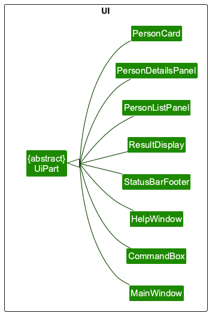
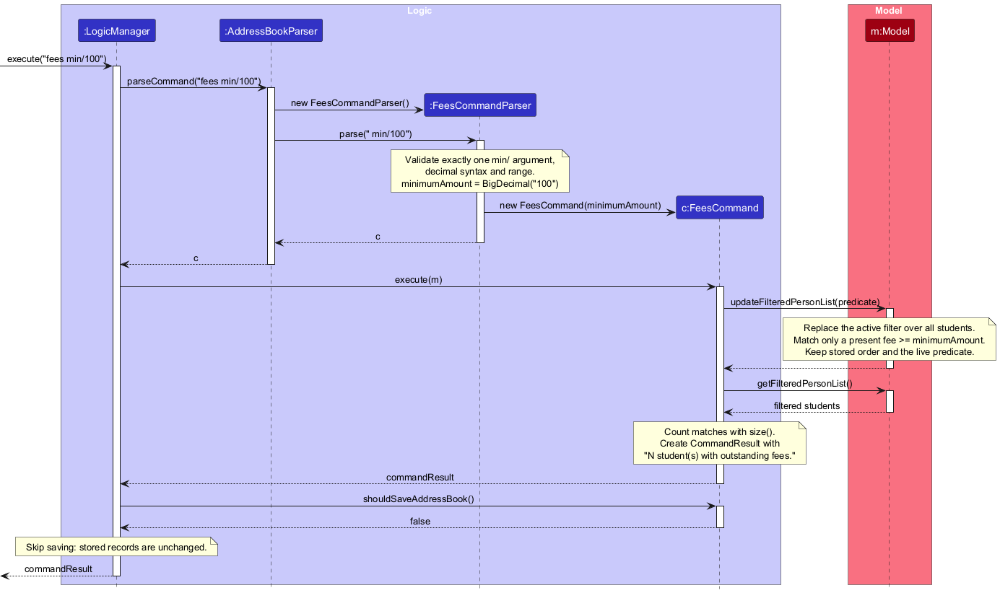
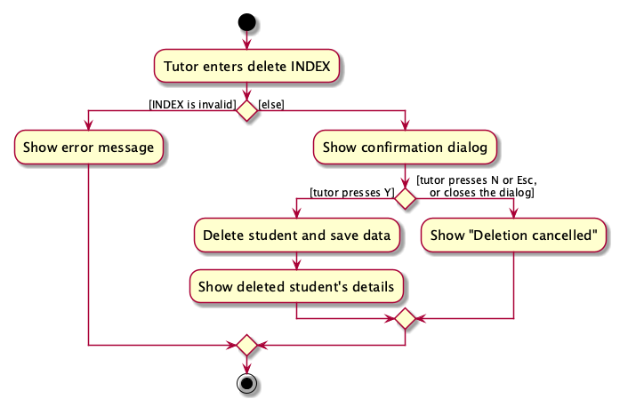
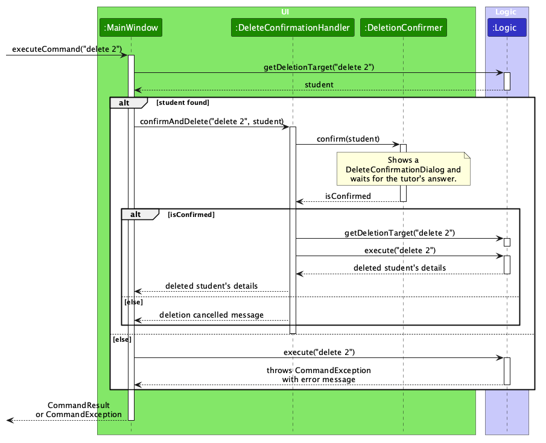
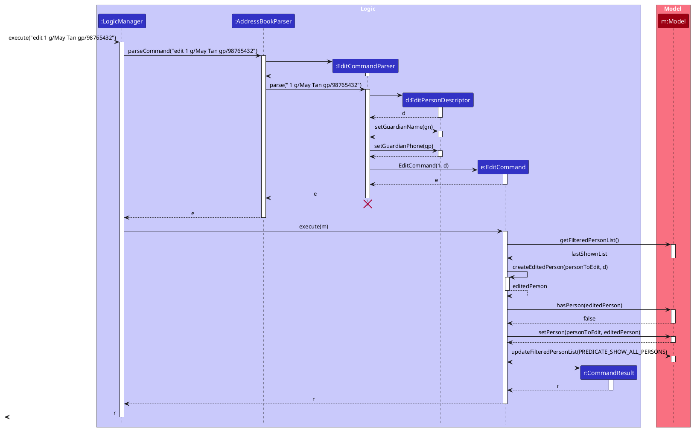
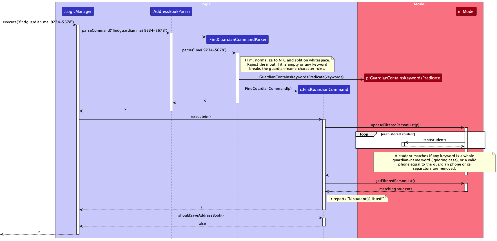

* Table of Contents
{:toc}

--------------------------------------------------------------------------------------------------------------------

## **Acknowledgements**

Poco Book is a brownfield project built on the **AddressBook-Level3 (AB3)** codebase that the CS2103T course supplies as the starting point for team projects (<https://github.com/se-edu/addressbook-level3>). The overall architecture, the Gradle build, the JavaFX scaffolding, the storage format and the structure of this Developer Guide follow AB3, which is the expected design reuse for a brownfield project. `build.gradle` lists the exact dependencies.

Third-party libraries:

* [JavaFX](https://openjfx.io/) 17.0.7 (`javafx-base`, `javafx-controls`, `javafx-fxml`, `javafx-graphics`) — the GUI toolkit.
* [Jackson](https://github.com/FasterXML/jackson) 2.7 (`jackson-databind`, `jackson-datatype-jsr310`) — reading and writing the `addressbook.json` and `preferences.json` files.
* [JUnit 5](https://junit.org/junit5/) — the test framework used by `src/test`.
* [Gradle](https://gradle.org/), [Checkstyle](https://checkstyle.org/) and [JaCoCo](https://www.jacoco.org/jacoco/) — build, style checking and coverage reporting.

Documentation and diagrams:

* Diagrams are written in [PlantUML](https://plantuml.com/) and use the colour definitions and layout conventions from the SE-EDU [_PlantUML tutorial_](https://se-education.org/guides/tutorials/plantUml.html).
* The documentation site uses [Jekyll](https://jekyllrb.com/) with the `_layouts`, `_includes` and `_sass` files carried over from AB3.

**AI assistance.** Members used generative AI coding assistants during the project, for example to draft code and tests, to review documentation and to speed up repetitive editing. Each member reviewed the changes that they merged and remains responsible for the resulting behaviour.

--------------------------------------------------------------------------------------------------------------------

## **Setting up, getting started**

Refer to the guide [_Setting up and getting started_](SettingUp.md).

--------------------------------------------------------------------------------------------------------------------

## **Design**

<div markdown="span" class="alert alert-primary">

:bulb: **Tip:** The `.puml` files used to create diagrams are in `docs/diagrams`. Refer to the [_PlantUML Tutorial_ at se-edu/guides](https://se-education.org/guides/tutorials/plantUml.html) to learn how to create and edit diagrams.
</div>

### Architecture


The ***Architecture Diagram*** given above explains the high-level design of the App.

The following provides a quick overview of the main components and their interactions.

**Main components of the architecture**

**`Main`** (consisting of classes [`Main`](https://github.com/AY2627S1-CS2103T-F09-2a/tp/tree/master/src/main/java/seedu/address/Main.java) and [`MainApp`](https://github.com/AY2627S1-CS2103T-F09-2a/tp/tree/master/src/main/java/seedu/address/MainApp.java)) is in charge of the app launch and shut down.
* At app launch, it initializes the other components in the correct sequence, and connects them up with each other.
* At shut down, it shuts down the other components and invokes cleanup methods where necessary.

The bulk of the app's work is done by the following four components:

* [**`UI`**](#ui-component): The UI of the App.
* [**`Logic`**](#logic-component): The command executor.
* [**`Model`**](#model-component): Holds the data of the App in memory.
* [**`Storage`**](#storage-component): Reads data from, and writes data to, the hard disk.

[**`Commons`**](#common-classes) represents a collection of classes used by multiple other components.

**How the architecture components interact with each other**

The *Sequence Diagram* below shows how the components interact with each other for the scenario where the user issues the command `delete 1`.


For simplicity, the diagram leaves out the confirmation that `delete` asks for before `Logic` executes it. See [Delete confirmation](#delete-confirmation).

Each of the four main components (also shown in the diagram above),

* defines its *API* in an `interface` with the same name as the Component.
* provides its functionality through a concrete `{Component Name}Manager` class that implements the corresponding API interface.

For example, the `Logic` component defines its API in `Logic.java` and implements it in `LogicManager.java`. Other components interact with a component through its interface rather than its concrete class, preventing them from coupling to that component's implementation, as illustrated in the following partial class diagram.


The sections below give more details of each component.

### UI component

The **API** of this component is specified in [`Ui.java`](https://github.com/AY2627S1-CS2103T-F09-2a/tp/tree/master/src/main/java/seedu/address/ui/Ui.java)


The UI consists of a `MainWindow` and its parts, such as `CommandBox`, `ResultDisplay`, `PersonListPanel`, `PersonDetailsPanel`, and `StatusBarFooter`. All of these, including `MainWindow`, inherit from the abstract `UiPart` class, which captures common behavior among classes that represent visible GUI parts. `MainWindow` also holds a `DeleteConfirmationHandler` and creates a `DeleteConfirmationDialog` when a deletion needs confirming. These two classes are not `UiPart`s; see [Delete confirmation](#delete-confirmation).

The class diagram below shows the UI classes that inherit from `UiPart`. It is drawn separately from the diagram above so that the lines in both diagrams stay readable.



The `UI` component uses the JavaFX UI framework. The layouts of these UI parts are defined in matching `.fxml` files in `src/main/resources/view`. For example, [`MainWindow.fxml`](https://github.com/AY2627S1-CS2103T-F09-2a/tp/tree/master/src/main/resources/view/MainWindow.fxml) specifies the layout of [`MainWindow`](https://github.com/AY2627S1-CS2103T-F09-2a/tp/tree/master/src/main/java/seedu/address/ui/MainWindow.java).

The `UI` component,

* executes user commands using the `Logic` component.
* listens for changes to `Model` data so that the UI can be updated with the modified data.
* keeps a reference to the `Logic` component, because the `UI` relies on the `Logic` to execute commands.
* depends on some classes in the `Model` component because it displays `Person` objects from the model.

For `view INDEX`, `ViewCommand` reads the student at that index in the filtered list and returns the `Person` in `CommandResult` with a feedback message. It does not update the filter or model. `LogicManager` skips the storage write because `ViewCommand.shouldSaveAddressBook()` returns false. `MainWindow` selects that person in `PersonListPanel`; the list selection updates `PersonDetailsPanel`, which shows all stored fields. The details pane unwraps optional student contact fields and shows `Not provided` when a field is absent. It formats an outstanding fee as `S$` followed by two decimal places, or `None` when absent. It lists tags, or `Tags: None` when there are none, in the order given by `Messages#sortTagNames(Collection)`: alphabetical order ignoring case, then character code (uppercase first) for names that differ only in case. Names are compared character by character, so length matters only when one name starts with the other, ignoring case, and the shorter name comes first (`bio` before `biology`). Digits are compared as characters too, so `Sec10` comes before `Sec3`. Student cards and the result of commands such as `edit` list tags in the same order. A failed parse or out-of-range index produces no `CommandResult`, so the current selection and details remain unchanged.

For `delete INDEX`, `MainWindow` asks the tutor to confirm before `Logic` executes the command. See [Delete confirmation](#delete-confirmation).

Before running a command, `MainWindow` notes which student is selected. After a successful command other than `view`, it calls `PersonListPanel#retainSelection`, which does one of the following:

* If the student is still in the displayed list, it selects them again, even if their index has changed.
* If the command replaced the student's record (`edit`, `setoutstanding` or `paid`) and the new record is still displayed, it selects the new record, so the details pane shows the updated fields. `edit` also resets the list to show all students, so an edited student always stays displayed.
* Otherwise, it clears the selection, which also clears the details pane.

A command can also fail after it has changed the data. For example, if saving to the data file fails, `paid 1` has already cleared the fee in memory when the error is shown. The list then chooses the highlighted row by position, not by student, so it may highlight a different student, such as Charlotte after `fees`, `view 1`, `paid 1`. So when a command fails, `MainWindow` calls `PersonListPanel#retainSelectionAfterFailure`. If the highlight has moved off the previously selected student, this corrects it as `retainSelection` does. Otherwise, such as after `view 99`, it changes nothing. It does not simply call `retainSelection`, because that also scrolls the list to bring the selected student to the top (or as far as the list can scroll), so the list would jump after every typing mistake.

To find out which records a command replaced, `PersonListPanel` listens to the full student list from `Logic#getPersonList()`. When a command replaces a record, that list reports the old record replaced by the new one. The panel does not use changes to the displayed list, because a search reports one change that removes all of the old results and adds all of the new ones. If the old and new results have the same number of students, pairing them by position would treat the student now at the selected index as the selected student's new record. For example, `find David`, `view 1`, `find Irfan` would then select Irfan. A search does not change the full list, so it never moves the selection to a different student. It keeps the selected student if the results include them, and clears the selection otherwise.

`PersonCard` shows each tag as a label in a `FlowPane`. A long tag is cut off with `...` so that it stays inside the card. `DarkTheme.css` sets two widths of 230 pixels:

* Each tag label is at most 230 pixels wide. The tag row is never narrower than 239 pixels: the student list is at least 300 pixels wide, even with the divider dragged fully left, and a selected card has a border.
* The tag row is at least 230 pixels wide. Without a minimum, a `FlowPane` is at least as wide as the full text of its widest tag, because `FlowPane#computeMinWidth` uses each tag's preferred width and ignores its maximum width, so a long tag pushed the row past the edge of the card. The card's height is calculated as if the tag row were 230 pixels wide, because the card's `GridPane` column has a preferred width of 150 pixels, which would otherwise give a narrower row. A card whose tags fit in fewer rows when the card is wider therefore has some blank space, for example in a wide window. A smaller minimum would add blank rows even on the narrowest cards.

The details pane wraps its text, so it shows long tags in full. Tag length is not limited: a card now fits a tag of any length, and data files from earlier versions may already contain longer tags, which would fail to load if the limit were checked when loading.

### Logic component

**Bulk clear policy:** `clear` removes the entire stored book in one successful command, regardless of the
current filter or extra arguments. Unlike `delete`, it has no confirmation step or built-in undo. The User
Guide explicitly warns tutors and explains how to back up the data file beforehand. A confirmation or
recovery workflow remains a separate design decision: it must cover cancellation, displayed-filter state,
unpaid fees and restart behavior before changing this command. Protecting the previous data file from a
*failed write* does not restore records after a *successful* `clear` save (see
[the save-safety change](https://github.com/AY2627S1-CS2103T-F09-2a/tp/pull/239)).

**API** : [`Logic.java`](https://github.com/AY2627S1-CS2103T-F09-2a/tp/tree/master/src/main/java/seedu/address/logic/Logic.java)

Besides `Logic#execute(String)`, the API has `Logic#getDeletionTarget(String)`, which parses a command without executing it and reports which displayed student a `delete` command would remove. The `UI` uses it to ask the tutor to confirm a deletion first; see [Delete confirmation](#delete-confirmation).

Here's a (partial) class diagram of the `Logic` component:


The sequence diagram below illustrates the interactions within the `Logic` component, taking `execute("delete 1")` API call as an example.


<div markdown="span" class="alert alert-info">:information_source: **Note:** The lifeline for `DeleteCommandParser` should end at the destroy marker (X), but due to a limitation of PlantUML, it continues to the end of the diagram.
</div>

How the `Logic` component works:

1. When `Logic` is called upon to execute a command, the command is passed to an `AddressBookParser` object, which in turn creates a parser that matches the command (e.g., `DeleteCommandParser`) and uses it to parse the command.
1. This results in a `Command` object (more precisely, an object of one of its subclasses e.g., `DeleteCommand`) which is executed by the `LogicManager`.
1. The command can communicate with the `Model` when it is executed (e.g. to delete a student).<br>
   In the diagram above, `DeleteCommand` gets the displayed list from the `Model` and uses `DeleteCommand#getTarget(List)` to find the student `p` at index 1 of that list. It then passes `p` itself, not the index, to `Model#deletePerson(Person)`. If the index is beyond the end of the list, `getTarget` returns an empty `Optional` instead, and `DeleteCommand` throws a `CommandException` without deleting anything. Other commands may need different or more interactions with the `Model`.
1. The result of the command execution is encapsulated as a `CommandResult` object which is returned from `Logic`.

Here are the other classes in `Logic` (omitted from the class diagram above) that are used for parsing a user command:


How the parsing works:
* When called upon to parse a user command, the `AddressBookParser` class creates an `XYZCommandParser` (`XYZ` is a placeholder for the specific command name, e.g., `AddCommandParser`). The parser uses the other classes shown above to parse the user command and create an `XYZCommand` object (e.g., `AddCommand`). The `AddressBookParser` returns that object as a `Command` object.
* All `XYZCommandParser` classes, such as `AddCommandParser` and `DeleteCommandParser`, implement the `Parser` interface so they can be treated similarly where appropriate, for example during testing.
* `AddressBookParser` matches the command word in any letter case, so `LIST` and `list` create the same command. Only the command word is converted; the arguments reach the `XYZCommandParser` unchanged. See [Command words and unknown commands](#command-words-and-unknown-commands).

### Model component
**API** : [`Model.java`](https://github.com/AY2627S1-CS2103T-F09-2a/tp/tree/master/src/main/java/seedu/address/model/Model.java)

<a href="images/ModelClassDiagram.png"></a>


The `Model` component,

* stores the address book data i.e., all `Person` objects (which are contained in a `UniquePersonList` object).
* stores the `Person` objects selected by the current filter, such as search results, in a separate _filtered_ list. It exposes this list as an unmodifiable `ObservableList<Person>` that the UI can observe and bind to, so the UI updates when the list changes.
* stores a `UserPrefs` object that represents the user’s preferences (currently, just the GUI settings). This is exposed to the outside as a `ReadOnlyUserPrefs` object.
* does not depend on any of the other three components (as the `Model` represents data entities of the domain, they should make sense on their own without depending on other components)

<div markdown="span" class="alert alert-info">:information_source: **Note:** The alternative, arguably more object-oriented, design below keeps a unique list of tags in `AddressBook`, and each `Person` references tags from that list. This lets `AddressBook` maintain one `Tag` object per unique tag instead of each `Person` holding its own `Tag` objects.<br>


</div>


### Storage component

**API** : [`Storage.java`](https://github.com/AY2627S1-CS2103T-F09-2a/tp/tree/master/src/main/java/seedu/address/storage/Storage.java)


The `Storage` component,
* can save both address book data and user preference data in JSON format, and read them back into corresponding objects.
* saves each file by writing a temporary file first and then replacing the old file with it, so a save that fails partway leaves the previous save intact (see [Saving data safely](#saving-data-safely)).
* is implemented by `StorageManager`, which delegates the actual JSON file access to `JsonAddressBookStorage` and `JsonUserPrefsStorage` (one class per data file).
* depends on some classes in the `Model` component (because the `Storage` component's job is to save/retrieve objects that belong to the `Model`)

**Supported usage constraint:** Only one running Poco Book instance may use a given home folder at a time.
Each instance loads its own in-memory copy of `data/addressbook.json`, and `LogicManager` saves that copy
after a data-changing command. The app does not synchronize instances or detect stale copies: a later save
from an older instance can silently replace records saved by another instance. Concurrent use of the same
home folder is outside the supported workflow; users are warned in the User Guide's quick start and FAQ.

### Common classes

Classes used by multiple components are in the `seedu.address.commons` package.

--------------------------------------------------------------------------------------------------------------------

## **Implementation**

This section describes some noteworthy details on how certain features are implemented.

### Minimum outstanding-fee filtering

The `fees [min/AMOUNT]` command replaces the displayed-list filter with one that selects students owing at least the given amount. It searches all stored students, not just the previous search results, and preserves their stored order.

#### Implementation

`AddressBookParser` delegates the arguments to `FeesCommandParser`. Plain `fees` creates a `FeesCommand` with a zero minimum. Otherwise, the parser requires exactly one `min/` prefix with no preamble, validates the amount using `OutstandingFee.VALIDATION_REGEX`, and checks that it does not exceed `99999.99`. The accepted threshold is an unsigned decimal from `0` to `99999.99`, with at most two decimal places. Invalid arguments cause a `ParseException` before command execution, leaving the records and current filter unchanged.

The sequence diagram below shows a successful `fees min/100` call. Tokenization, predicate evaluation and result construction are summarized in notes rather than shown as separate lifelines.

The essential sequence is: `LogicManager#execute` parses the input through `AddressBookParser` and
`FeesCommandParser`; `FeesCommand#execute` installs the fee predicate with `Model#updateFilteredPersonList`,
reads the filtered list size, and returns the result. `LogicManager` does not save this read-only command.
For small screens, open the [full-size fee sequence diagram](images/FeesSequenceDiagram.png) to read its notes
and message labels without shrinking them to the page width.

[](images/FeesSequenceDiagram.png)

Diagram source: [FeesSequenceDiagram.puml](diagrams/FeesSequenceDiagram.puml).

`FeesCommand#execute` calls `Model#updateFilteredPersonList` with a predicate. For a positive minimum, it selects only students with a present outstanding fee whose `BigDecimal` value compares greater than or equal to the minimum. Plain `fees` and `fees min/0` use `PREDICATE_HAS_OUTSTANDING_FEE`; students without a fee remain excluded. The command counts the resulting list and returns the existing `N student(s) with outstanding fees.` feedback. `LogicManager` skips saving because `FeesCommand#shouldSaveAddressBook()` returns `false`.

`ModelManager` installs the predicate on its existing `FilteredList`, rather than taking a snapshot. Subsequent fee replacements are therefore re-evaluated against the same minimum: after `fees min/100`, changing a displayed student's fee to `99.99` removes that student from the results, while changing it to exactly `100` retains them. Commands accepting an index continue to use the current displayed list; `list` restores all students.

#### Design considerations

* **Exact, inclusive comparison.** `BigDecimal.compareTo` avoids floating-point rounding and treats thresholds such as `100` and `100.00` identically. The threshold may be zero even though a stored `OutstandingFee` must be positive.
* **Live filter rather than a copied result list.** Reusing the model's filtering mechanism preserves automatic updates when fees change, without adding a separate collection or changing the storage schema.
* **Read-only query.** Filtering changes only the displayed view, not student records. Skipping the storage write avoids unnecessary disk access and unrelated save errors.

### Delete confirmation

`delete INDEX` asks the tutor to confirm before a student is deleted, because a deleted student cannot be restored. Asking for confirmation is UI behaviour, so it is handled in the `UI` component. `Logic` gains only a query method, `Logic#getDeletionTarget(String)`, which reports which student a command would delete without executing it. `Model` and `Storage` are unchanged, and deletion and saving still use the existing path.

The activity diagram below shows what happens when the tutor enters `delete INDEX`.



`MainWindow#executeCommand(String)` decides whether a command needs confirmation:

1. It calls `Logic#getDeletionTarget(String)`. `LogicManager` parses the input with its `AddressBookParser`, the same parser that `Logic#execute(String)` uses. If the input is a `delete` command, `LogicManager` calls `DeleteCommand#getTarget(List)` with the displayed list, so the index refers to the same list, such as `find` or `fees` results, as it does when `DeleteCommand` executes.
1. If there is no target, `MainWindow` passes the input to `Logic#execute(String)`, as it did before this feature. This happens when the input is another command, cannot be parsed, or has an index beyond the end of the list. Invalid `delete` commands therefore report the usual errors without opening a dialog.
1. Otherwise, `MainWindow` calls `DeleteConfirmationHandler#confirmAndDelete(String, Person)` with the target. The handler asks its `DeletionConfirmer` whether to delete the student. In the app, `MainWindow` supplies a confirmer that opens a `DeleteConfirmationDialog` over the main window and waits for the tutor to respond.
1. If the tutor cancels, the handler returns a `CommandResult` with a cancellation message without calling `Logic#execute(String)`, so nothing is deleted or saved. `MainWindow` then restores the selection as it does after any other successful command.
1. If the tutor confirms, the handler calls `Logic#getDeletionTarget(String)` again to check that the index still identifies the same student. It then calls `Logic#execute(String)`, which deletes the student and saves the data as before. While the dialog is open, the tutor cannot enter commands, so the displayed list cannot change. The second check is a safeguard in case a future change allows the list to change during confirmation: if a different student now has that index, or the student's details have changed, the handler throws a `CommandException` and deletes nothing.

The sequence diagram below shows these steps for `delete 2`, including the second check and the `CommandException` with `DeleteConfirmationHandler.MESSAGE_TARGET_CHANGED` that the handler throws if that check fails.



`DeleteConfirmationDialog` shows a JavaFX `Alert` with the student's name, phone, guardian name and guardian phone. Together, the name and guardian phone identify a student in Poco Book, so they tell apart students who share a name. The dialog works as follows:

* Pressing Y deletes the student, and pressing N keeps them. Pressing Esc or closing the window also keeps the student.
* Y or N pressed together with Control, Command (Meta) or Alt is ignored, so a key combination cannot answer the dialog. Each of these keys is checked separately, because `KeyEvent#isShortcutDown()` checks only Command on macOS. Shift is allowed, so an uppercase Y or N still answers.
* All other key presses except Esc, including Enter and Space, are consumed without answering the dialog, so no button or keyboard shortcut in the dialog can act on them. Esc is left to the **Cancel (N)** button. If the tutor presses Enter twice, or starts typing the next command before noticing the dialog, those keys go to the dialog. No command word starts with Y or N, so the start of the next command cannot answer the dialog, although a Y or N typed later would. D was avoided because `delete` starts with D.
* The **Delete (Y)** and **Cancel (N)** buttons can be clicked, but the keyboard cannot reach them: Tab does not move to them, and Enter and Space do not press them. When a dialog opens, JavaFX gives keyboard focus to its main button. The Delete button is therefore created as a secondary button (`ButtonData.APPLY`) rather than the main one (`ButtonData.OK_DONE`), so that it never starts with focus.
* If the student still owes a fee, the dialog shows a warning icon and a red banner stating the amount, because deleting the student also deletes the unpaid fee. Pressing Y still deletes the student.
* The dialog is 680 pixels wide, and long names wrap rather than widening it. A 1280x720 screen at 150% scaling leaves about 853 by 432 pixels above a Windows 11 taskbar; `DeleteConfirmationDialogTest` checks that the dialog, with the longest valid names and a fee, fits within that area.

#### Design considerations

**Aspect: Where to ask for confirmation**

* **Alternative 1 (current choice):** Ask in the `UI`, which first calls `Logic#getDeletionTarget(String)`.
  * Pros: `Logic` contains no UI code and never waits for the tutor. The `UI` uses only the `Logic` API, and deletion and saving still use the existing path.
  * Cons: The `Logic` API gains a method that only `delete` uses. Asking and deleting are separate steps, so the target must be checked again after confirmation. Most commands are parsed twice; see the next aspect.
* **Alternative 2:** Let `DeleteCommand#execute(Model)` call a confirmation callback that the `UI` provides.
  * Pros: Each command is parsed once. Asking and deleting happen in one step, so no second check is needed.
  * Cons: `Logic` would wait on a UI dialog in the middle of a command. The `UI` can only provide the callback after `Logic` is created, so `Logic` would need a setter. The callback would also have to reach each `DeleteCommand`, either through `AddressBookParser` and `DeleteCommandParser`, or by `LogicManager` handing it over after parsing.
* **Alternative 3:** Let the `UI` parse the input with its own `AddressBookParser`.
  * Pros: The `Logic` API is unchanged.
  * Cons: The `UI` would depend on classes that are internal to `Logic`, breaking the rule that components interact only through each other's APIs.

**Aspect: How often to parse the input**

* **Alternative 1 (current choice):** Each call to `Logic` parses the command text again.
  * Pros: The `UI` decides whether to ask with the same parser that `Logic#execute(String)` uses, so every input that would delete a student is confirmed first. The `Logic` API takes plain text, and parse errors are reported in one place, by `Logic#execute(String)`.
  * Cons: Most commands are parsed twice, a cancelled `delete` once and a confirmed `delete` three times. Measured on JDK 25, the extra parsing costs at most about 1 ms per command just after startup, and far less once the JVM has warmed up, well within the 1-second target of [NFR 2](#non-functional-requirements).
* **Alternative 2:** Parse once. `Logic` returns an opaque prepared command, which the `UI` passes back to `Logic` to find the target and to execute it.
  * Pros: Each command is parsed once, and the check after confirmation needs no parsing.
  * Cons: The `Logic` API gains a type and changes two methods, and the `UI` holds the prepared command while the dialog is open. The check after confirmation is still needed. The prepared command must hide the parsed `Command`, or the `UI` would depend on classes internal to `Logic`.
* **Alternative 3:** Check the command word before parsing, and parse fully only for `delete`.
  * Pros: Other commands are parsed once, and only `LogicManager` changes.
  * Cons: `delete` would be recognised in two places. If they drifted apart, for example if the parser accepted an alias, or a command word in upper case, that the check did not, a deletion could run without asking.

**Testing**

* `DeleteConfirmationHandlerTest` replaces the dialog with a confirmer that records each request and returns a fixed answer. It covers confirming, cancelling, deleting from `find` and `fees` results, and a list that changes or empties, or a student whose details change, during confirmation, all without a display.
* `LogicManagerTest` checks that `Logic#getDeletionTarget(String)` finds the displayed student for a valid `delete` command, and finds no student for other commands or for invalid or malformed indexes.
* `DeleteConfirmationDialogTest` checks the dialog's content, fee warning, keys, buttons and size with JavaFX. It checks that Enter, Tab, Space, the letters of a typed command, Y with Control, Command (Meta) or Alt, and N with Control each leave the dialog open, and that such key presses cannot reach a keyboard shortcut. It also checks that Shift+Y, and Y for a student who owes a fee, still confirm, and that the longest valid names fit with a fee warning without cut-off text.
* `MainWindowDeletionTest` builds the full main window, types each command into the window's own command box, and reads the feedback the window displays. With a confirmer that records each request instead of showing a dialog, it checks that a confirmed `delete` removes the student, that a cancelled one keeps them, and that a command without a deletion target and an index outside the displayed list never reach the handler, which covers the branch in `MainWindow#executeCommand(String)` that connects these parts. Two further tests use the public constructor, so the dialog `MainWindow` shows is opened for real, and answer it with Y and with N.
* Like the other JavaFX tests, the last two need the environment variable `POCO_UI_TESTS` to be `true`.
* The manual tests in [Deleting a student](#deleting-a-student) still check the dialog that a real tutor sees.

The `JavaFX UI tests` job in the Java CI workflow sets `POCO_UI_TESTS` and runs `./gradlew test coverage` under `xvfb-run` on a Linux runner, so the JavaFX suite executes in a virtual display on every push instead of being gated off. A follow-up step, [`.github/verify-ui-test-results.py`](../.github/verify-ui-test-results.py), reads the JUnit report and fails the job if any test that the variable gates was skipped rather than executed. That job runs beside the three required cross-platform builds, which keep their own settings, and uploads its coverage to Codecov alongside them so the dialog and window lines are measured in CI.

### Adding a charge to an outstanding fee

A tutor who bills the same student again before the earlier amount is settled needs to add to the recorded fee, not replace it. `setoutstanding INDEX +AMOUNT` performs that addition, so the tutor does not have to work out the new total and cannot drop the earlier charge by mistyping the sum.

#### Implementation

`SetOutstandingCommandParser` treats a leading `+` as the only difference between the two meanings of the command. It strips the sign, validates the remaining digits with `OutstandingFee.VALIDATION_REGEX` and `OutstandingFee#isValidOutstandingFee`, and then builds the command with `SetOutstandingCommand#addToOutstandingFee(Index, OutstandingFee)`. Replacement, addition and clearing therefore share one parser and one command class, so `setoutstanding` keeps a single entry in `AddressBookParser`, in the user guide and in the command summary.

`SetOutstandingCommand` keeps a `boolean` that records which meaning was parsed. For an addition, `execute` reads the current amount from `Person#getOutstandingFee()`, which returns an `Optional`, treats an absent fee as `BigDecimal.ZERO`, adds the parsed amount and rebuilds the `Person` with every other field copied verbatim. Two guards run before the record is written:

* `+0` is rejected at parse time with `MESSAGE_INVALID_INCREMENT`, because adding nothing is either a typo or a no-op that would still cost the tutor a step.
* If the sum would exceed the `S$99999.99` cap, `execute` throws `CommandException` with `MESSAGE_TOTAL_TOO_LARGE`, which names the amount that was refused and the total it would have produced. The bounds check runs before `new OutstandingFee(...)`; otherwise the value object's own `checkArgument` would throw an `IllegalArgumentException`, which no caller turns into a message for the tutor.

Feedback for an addition reports the transition rather than only the new value — `Added S$50.00 to the outstanding fee for Alex Yeoh: S$120.00 -> S$170.00` — so the tutor can confirm what the previous balance was. Replacement and clearing keep their existing feedback.

#### Design considerations

* **An addition mode on `setoutstanding` instead of a new `charge` command (current choice).** The parser already owns `INDEX AMOUNT`, and the `+` prefix is the same convention the tutor sees on a receipt. One command word, one parser, one success message family and one help entry stay in step, and the change is a few dozen lines inside the existing class instead of a new command, parser, `AddressBookParser` case, help entry and test suite.
  * Cons: `+AMOUNT` is a second grammar in the same command, so the user guide has to explain both forms, and the two forms have different bounded ranges (`0` clears but `+0` is invalid).
* **A separate `charge` command.** This keeps every command with exactly one grammar, which is easier to document and to test.
  * Cons: it duplicates index validation and the copy-then-replace of `Person`, and a tutor who wants to correct an amount still needs `setoutstanding` as well, so the two commands must be read together to understand one field.
* **Recording a payment history instead of a running total.** Storing each charge as a row would make partial payments and statements possible.
  * Cons: it changes the storage format, the `Person` model and the fee total calculations in one step, which is a larger change than the iteration allows. The running total stays the single source of truth for v1.5.

#### Testing

`SetOutstandingCommandParserTest` covers `+50`, `+0.01`, `+99999.99` and the `AddressBookParser` route, and rejects `+0`, `+`, `++50`, `+50.001`, `+100000` and `+abc`. `SetOutstandingCommandTest` checks that an addition to an existing fee increases the total and preserves every other field, that an addition to a student with no fee records the added amount, that an addition to exactly `S$99999.99` succeeds, and that an addition beyond the cap is rejected with the record unchanged.

### Fee summary and full-payment commands

The all-student fee total (`feesummary`) and full-payment recording (`paid`) extend the outstanding-fee feature described under the Logic and Model components. Both commands work on the immutable `OutstandingFee` value object, so no `Person`, `Model` or storage-format change was needed for v1.4.

#### Implementation

`FeeSummaryCommand` walks every person in the **complete** address book via `Model#getAddressBook()#getPersonList()` rather than the filtered list, keeps a running `BigDecimal` total and a count of students whose fee is present, and formats the result with `toPlainString()` so two decimal places are always shown. The feedback explicitly says "Across all stored students" and "Displayed list unchanged" to make that scope visible in the app. Iterating the unfiltered book is what makes the total independent of the current `find`/`fees` filter. The command also overrides `Command#shouldSaveAddressBook()` to return `false`, so `LogicManager` does not write to storage for a pure query. `FeeSummaryCommandParser` rejects any argument with `MESSAGE_INVALID_COMMAND_FORMAT`, which keeps `feesummary 1` from being silently accepted.

`PaidCommand` holds an `Index` that was validated by `ParserUtil#parseIndex` at parse time. During execution it (i) rejects an index outside the displayed list, (ii) looks up the target `Person` in that displayed list, and (iii) fails with a user-facing `CommandException` when the fee is absent (`Person#getOutstandingFee()` returns an `Optional`). Only after those checks does it construct a replacement `Person` with every other field copied verbatim — name, optional phone/email/address, guardian name and phone, and tags — and call `Model#setPerson(...)`. Because the `Person` is immutable, this copy-then-replace step is what preserves the fields the command does not touch, and because `setPerson` goes through the updated address book, the active filter and the GUI selection are refreshed by the usual `FilteredList`/`ObservableList` listeners.

The sequence of interactions for a successful payment is shown below.


The corresponding sources are `docs/diagrams/PaidSequenceDiagram.puml`, `FeeSummaryCommand`, `PaidCommand`, `FeeSummaryCommandParser`, `PaidCommandParser` and the `AddressBookParser` cases that register `feesummary` and `paid`.

#### Design considerations

* **Query vs mutation.** Only `paid` mutates and saves; `feesummary` opts out of saving so that a read-only command cannot report a save failure the user cannot act on.
* **Exact money arithmetic.** Amounts use `BigDecimal` rather than `double`, so totals of many two-decimal fees cannot drift by a cent, and the summary can legitimately exceed the S$99999.99 per-student cap.
* **Displayed list vs complete book.** `paid` takes a one-based index into the *displayed* list, matching `delete`, `edit`, `view` and `setoutstanding`, so the student the tutor sees at that position is the student who is charged. `feesummary` deliberately does not: it totals every stored student, including students hidden by the current `find` or `fees` filter, for the reason given in alternative (a) below.
* **Scope shown in feedback.** The two commands therefore differ in scope on purpose, and both word their feedback to say which scope they used: `paid` names the student whose fee it cleared (`Marked outstanding fee as paid for Alex Yeoh: S$120.00`), while `feesummary` starts with `Across all stored students` and ends with `Displayed list unchanged`.
* **Index shift after `paid`.** The cost of the index-based `paid` is that, in a `fees` result, a paid student drops out of the list, so the students below them move up one index and the tutor must re-read the index before the next `paid`.
* **Alternatives considered.** (a) Making `feesummary` respect the current filter was rejected because a filtered total is easy to misread as the amount still owed overall. (b) Making `paid` accept a partial amount was rejected for v1.4: it needs a payment-history model, which is a larger change than the iteration allows, so `setoutstanding INDEX 0` and `paid INDEX` both clear a whole fee. (c) Reusing `setoutstanding` with amount `0` instead of adding `paid` was considered, but a dedicated command gives clearer feedback (`S$AMOUNT` cleared) and cannot be confused with re-setting a fee.

### Editing guardian contact details

The `edit` command supports updating a student's guardian name (`g/`) and guardian phone number (`gp/`) alongside existing student fields while preserving required-field invariants and duplicate-student checks.

#### Implementation

`EditCommandParser` tokenizes `g/` (`PREFIX_GUARDIAN_NAME`) and `gp/` (`PREFIX_GUARDIAN_PHONE`) together with the existing student prefixes, rejects duplicate `g/` or `gp/` prefixes via `ArgumentMultimap#verifyNoDuplicatePrefixesFor(...)`, and validates any supplied values through `ParserUtil#parseGuardianName` and `ParserUtil#parseGuardianPhone` before storing them on `EditPersonDescriptor`. It also explicitly tokenizes and rejects `f/` (`PREFIX_OUTSTANDING_FEE`) so that fee edits must go through `setoutstanding` or `paid` rather than being absorbed into an adjacent field value.

During execution, `EditCommand#execute(Model)` looks up `personToEdit` from `Model#getFilteredPersonList()` and constructs `editedPerson` via `EditCommand#createEditedPerson(personToEdit, editPersonDescriptor)`. Unedited fields fall back to the existing values on `personToEdit`, including `personToEdit.getOutstandingFee()`. Because student identity in `Person#isSamePerson(Person)` is defined by the combination of student `Name` (case-insensitive, whitespace-normalized) and `GuardianPhone`, editing `gp/` (or `n/`) can change a student's identity. Whenever `!personToEdit.isSamePerson(editedPerson)` holds, `EditCommand` checks `Model#hasPerson(editedPerson)` before calling `Model#setPerson(personToEdit, editedPerson)`, throwing a `CommandException` if the updated `(Name, GuardianPhone)` pair would collide with another existing student.

The descriptor distinguishes omitted optional contacts from explicit clearing: an omitted `p/`, `e/` or `a/` leaves that contact unchanged, while an empty value clears it. Guardian fields remain required. A supplied `t/` replaces the tag set; a lone empty `t/` clears all tags. Combining an empty `t/` with a nonempty tag is rejected. The command rejects an unchanged record before replacing it, while case-only changes remain valid updates.

Changing a guardian phone updates only the selected student. The success feedback names any other students who still have the old phone; the tutor must edit those records separately. The details pane is refreshed explicitly after selection retention, including the command-failure path, because a replacement record may compare equal despite a case-only display change.

The sequence diagram below shows the interactions within the `Logic` and `Model` components for `edit 1 g/May Tan gp/98765432`.



The corresponding sources are `docs/diagrams/GuardianEditSequenceDiagram.puml`, `EditCommand`, `EditCommand.EditPersonDescriptor` and `EditCommandParser`.

#### Design considerations

* **Guardian fields remain mandatory.** Unlike optional student contact fields (`p/`, `e/`, `a/`), every student record requires a guardian name and guardian phone number, so `g/` and `gp/` cannot be cleared to empty values via `edit`.
* **Identity-aware duplicate check.** Because `Person#isSamePerson` uses both `Name` and `GuardianPhone`, updating `g/` alone preserves identity whereas updating `gp/` triggers `Model#hasPerson(editedPerson)` to prevent duplicate `(Name, GuardianPhone)` records while still allowing two siblings with different names to share the same guardian phone number.
* **Alternatives considered.** Introducing a separate `editguardian` command was rejected because tutors frequently correct student and guardian details together after a phone call or form update; extending `edit` with `g/` and `gp/` keeps a single command for field-level updates.

### Guardian search

The `findguardian KEYWORD [MORE_KEYWORDS]...` command lists students whose guardian matches any keyword, so a tutor can identify a student when a guardian calls or messages. Like `find`, it searches all stored students, keeps their stored order and re-indexes the results.

#### Implementation

`AddressBookParser` passes the arguments to `FindGuardianCommandParser`. The parser trims the arguments, normalizes them to Unicode NFC and splits them on whitespace. Each keyword must match `GuardianName.VALIDATION_REGEX` or be a valid `GuardianPhone`, so it may contain only letters, combining marks, digits, apostrophes, hyphens, periods and parentheses, or be a phone starting with `+65`. Unlike a stored guardian name, a keyword does not need a letter, so phone keywords such as `9234-5678` are accepted. Empty input, or a keyword with any other character (such as the `/` in `g/Mei`), causes a `ParseException`, so the current filter is left unchanged. The keywords are wrapped in a `GuardianContainsKeywordsPredicate`, which is passed to a new `FindGuardianCommand`.

The sequence diagram below shows a successful `findguardian mei 9234-5678` call.

The essential sequence is: `LogicManager#execute` asks `AddressBookParser` and `FindGuardianCommandParser`
to parse the keywords; `FindGuardianCommand#execute` installs the guardian predicate through
`Model#updateFilteredPersonList` and reports the filtered list size. `LogicManager` does not save the search.
For small screens, open the [full-size guardian-search sequence diagram](images/FindGuardianSequenceDiagram.png)
to read its notes and message labels without shrinking them to the page width.

[](images/FindGuardianSequenceDiagram.png)

Diagram source: [FindGuardianSequenceDiagram.puml](diagrams/FindGuardianSequenceDiagram.puml).

`FindGuardianCommand#execute` calls `Model#updateFilteredPersonList` with the predicate. `GuardianContainsKeywordsPredicate#test` returns true when any keyword

* equals a whole word of the guardian name, ignoring case (`StringUtil#containsWordIgnoreCase`), or
* is a valid `GuardianPhone` that equals the stored guardian phone after its spaces, hyphens and `+65` country code are removed, so `9234-5678` and `+6592345678` match a guardian stored as `92345678`.

The command then reports the size of the filtered list with the shared `N student(s) listed!` message. `FindGuardianCommand#shouldSaveAddressBook()` returns `false`, so `LogicManager` does not write to storage.

#### Design considerations

* **Separate command rather than a `find` option.** Keeping `find` limited to student names follows feature 3 of the specification, which avoids surprising matches through guardian or contact details. A separate `findguardian` makes the searched field explicit.
* **Whole-word name matching.** Words are split on whitespace only, so `Anne-Marie` matches the keyword `anne-marie` but not `anne`. This is consistent with `find`.
* **Phone keywords are normalized like stored phones.** Tutors may type a number the way it was entered with `add`, including a hyphen. Partial numbers such as `9234` never match, which keeps results predictable.
* **Predicate copies its keywords.** `GuardianContainsKeywordsPredicate` stores `List.copyOf(keywords)`, so a caller changing its list later cannot silently change an installed filter.

### Saving data safely

If a save stops partway, for example because the disk is full, the data file must still hold the last successful save. Otherwise, Poco Book cannot load the file at the next launch, and every saved student is lost.

#### Implementation

`JsonAddressBookStorage` and `JsonUserPrefsStorage` save through `JsonUtil#saveJsonFile(T, Path)`, which converts the data to JSON and passes it to `FileUtil#writeToFile(Path, String)`. That method never writes to the data file itself:

1. If the data file exists, it checks that the file is writable, by opening it for writing and closing it without changing it. If the file is read-only, or is a folder, saving fails with the same error as before. The check is needed because on macOS and Linux, step 3 can replace a read-only file, so a read-only data file would otherwise be overwritten.
1. It writes the JSON to a new temporary file in the same folder, such as `data/addressbook.json.5784445305140543549.tmp`.
1. It replaces the data file with the temporary file using `Files#move` with `ATOMIC_MOVE`, so the data file always holds either its old or its new content. If the file system cannot replace a file in one step, saving fails. It does not fall back to an ordinary move, because that deletes the data file before moving the new one, so a failure would lose both.
1. If any step fails, it deletes the temporary file where possible and throws the `IOException`. `LogicManager` reports it as a save error, as before.

Saving now also needs permission to create files in the data folder. If Poco Book cannot create files there, saving fails even if the data file itself is writable.

On macOS and Linux, the temporary file is given the permissions of the data file it replaces, so saving does not change the permissions of an existing file. A file that does not exist yet gets the permissions of the temporary file, which only its owner can read and write (`rw-------`). This applies to a new `preferences.json`, which holds only the window size and position. A new `data/addressbook.json` still gets the default permissions for new files, such as `rw-r--r--`, because `JsonAddressBookStorage` creates the empty file before saving to it.

Saving does not undo the change in the app's memory: as before, a change that could not be saved stays in the app while it is open. Closing Poco Book does not save student data, so if it is closed before another save succeeds, the change is lost and the next launch loads the last successful save. If a later command saves successfully, that save also writes the earlier change, because each save writes all the data in memory.

Every save creates a temporary file, which normally replaces the data file and so does not remain. If Poco Book stops while saving, for example because of a power cut, the temporary file may be left in the folder. Poco Book loads only the data file, never a leftover temporary file, so it can be deleted.

#### Design considerations

**Aspect: How to save without losing the previous save**

* **Alternative 1 (current choice):** Write a temporary file in the same folder, then replace the data file with it.
  * Pros: The data file is never partly written. Replacing a file in one step works on Windows, macOS and Linux when both files are in the same folder.
  * Cons: Poco Book must be allowed to create files in the data folder, not just to change the data file. It also needs the extra check in step 1, because on macOS and Linux the replacement would otherwise overwrite a read-only data file. On Windows, the replacement can also fail if another program, such as an antivirus scanner or a file sync tool, has the data file or the temporary file open at that moment. Poco Book does not retry. The command reports a save error: a permission error if Windows denies access to the file, or a general save error if Windows reports that the file is in use. Either way, the previous save stays intact, and a later successful save also writes the change that could not be saved.
* **Alternative 2:** Write over the data file directly, as AB3 did.
  * Pros: Simpler.
  * Cons: A save that stops partway leaves a partly written file, which cannot be loaded.
* **Alternative 3:** Copy the data file to a backup before each save.
  * Pros: A partly written file could be recovered from the backup.
  * Cons: Poco Book would have to detect a damaged file and restore the backup at startup, and each save would write the data twice.

**Testing**

`FileUtilTest` replaces the step that writes the temporary file with one that writes half the content and then fails, as a full disk would. It checks that the data file keeps its old content and that no temporary file remains. Another replacement writes the whole temporary file and then makes the folder read-only, so that only the replacing fails. The tests also check a read-only file, a read-only folder, a folder in place of the file, a symbolic link and file permissions. A test that needs permissions or symbolic links is skipped where the system does not support them, such as read-only folders on Windows.

### \[Proposed\] Undo/redo feature

#### Proposed Implementation

The proposed undo/redo mechanism is facilitated by `VersionedAddressBook`. It extends `AddressBook` with an undo/redo history, stored internally as an `addressBookStateList` and `currentStatePointer`. Additionally, it implements the following operations:

* `VersionedAddressBook#commit()` — Saves the current address book state in its history.
* `VersionedAddressBook#undo()` — Restores the previous address book state from its history.
* `VersionedAddressBook#redo()` — Restores a previously undone address book state from its history.

These operations are exposed in the `Model` interface as `Model#commitAddressBook()`, `Model#undoAddressBook()` and `Model#redoAddressBook()` respectively.

Given below is an example usage scenario and how the undo/redo mechanism behaves at each step.

Step 1. The user launches the application for the first time. The `VersionedAddressBook` will be initialized with the initial address book state, and the `currentStatePointer` pointing to that single address book state.


Step 2. The user executes `delete 5` command to delete the 5th person in the address book. The `delete` command calls `Model#commitAddressBook()`, causing the modified state of the address book after the `delete 5` command executes to be saved in the `addressBookStateList`, and the `currentStatePointer` is shifted to the newly inserted address book state.


Step 3. The user executes `add n/David …​` to add a new person. The `add` command also calls `Model#commitAddressBook()`, causing another modified address book state to be saved into the `addressBookStateList`.


<div markdown="span" class="alert alert-info">:information_source: **Note:** If a command fails its execution, it will not call `Model#commitAddressBook()`, so the address book state will not be saved into the `addressBookStateList`.

</div>

Step 4. The user now decides that adding the person was a mistake, and decides to undo that action by executing the `undo` command. The `undo` command will call `Model#undoAddressBook()`, which will shift the `currentStatePointer` once to the left, pointing it to the previous address book state, and restores the address book to that state.


<div markdown="span" class="alert alert-info">:information_source: **Note:** If the `currentStatePointer` is at index 0, pointing to the initial AddressBook state, then there are no previous AddressBook states to restore. The `undo` command uses `Model#canUndoAddressBook()` to check if this is the case. If so, it will return an error to the user rather
than attempting to perform the undo.

</div>

The following sequence diagram shows how an undo operation goes through the `Logic` component:


<div markdown="span" class="alert alert-info">:information_source: **Note:** The lifeline for `UndoCommand` should end at the destroy marker (X), but due to a limitation of PlantUML, it continues to the end of the diagram.

</div>

Similarly, how an undo operation goes through the `Model` component is shown below:


The `redo` command does the opposite — it calls `Model#redoAddressBook()`, which shifts the `currentStatePointer` once to the right, pointing to the previously undone state, and restores the address book to that state.

<div markdown="span" class="alert alert-info">:information_source: **Note:** If the `currentStatePointer` is at index `addressBookStateList.size() - 1`, pointing to the latest address book state, then there are no undone AddressBook states to restore. The `redo` command uses `Model#canRedoAddressBook()` to check if this is the case. If so, it will return an error to the user rather than attempting to perform the redo.

</div>

Step 5. The user then decides to execute the command `list`. Commands that do not modify the address book, such as `list`, will usually not call `Model#commitAddressBook()`, `Model#undoAddressBook()` or `Model#redoAddressBook()`. Thus, the `addressBookStateList` remains unchanged.


Step 6. The user executes `clear`, which calls `Model#commitAddressBook()`. Since the `currentStatePointer` is not pointing at the end of the `addressBookStateList`, all address book states after the `currentStatePointer` will be purged. Reason: It no longer makes sense to redo the `add n/David …​` command. This is the behavior that most modern desktop applications follow.


The following activity diagram summarizes what happens when a user executes a new command:


#### Design considerations:

**Aspect: How undo & redo execute:**

* **Alternative 1 (current choice):** Saves the entire address book.
  * Pros: Easy to implement.
  * Cons: May have performance issues in terms of memory usage.

* **Alternative 2:** Individual command knows how to undo/redo by
  itself.
  * Pros: Will use less memory (e.g. for `delete`, just save the person being deleted).
  * Cons: We must ensure that the implementation of each individual command is correct.

Undo/redo is not implemented in v1.5. The walkthrough and activity diagram above describe the inherited SE-EDU AB3 design where individual commands call `Model#commitAddressBook()`. The two aspects below record why an alternative architecture was considered for Poco Book:

**Aspect: Where history is committed:**

* **Alternative 1 (proposed):** `LogicManager#execute` commits once, after a successful execution.
  * Pros: One place decides when a state is worth recording, so a new command cannot forget to commit, and a command that throws never records a state.
  * Cons: The history records every saving command, including a `setoutstanding` that restored the previous amount.
* **Alternative 2 (legacy walkthrough above):** Each `Command` calls `Model#commitAddressBook()` inside `execute`.
  * Pros: The command decides whether its change is worth an undo step, so a no-op `setoutstanding` could be skipped.
  * Cons: The rule is spread over every command, and a command that forgets the call silently loses its undo step.

**Aspect: What is kept out of the history:**

* **Alternative 1 (proposed):** Only saving commands are recorded, so `list`, `find`, `fees`, `findguardian` and `feesummary` leave the history untouched and `undo` always reverses a change to the stored records.
  * Pros: `undo` is never spent on a display-only command, and the number of undo steps matches the number of changes the tutor made.
  * Cons: `undo` does not restore the previous filter, so the displayed list after an `undo` can differ from the list before the undone command.
* **Alternative 2:** Record every command, including display-only ones.
  * Pros: `undo` would restore the exact previous view.
  * Cons: A tutor who filtered a few times would need several `undo` commands before reaching the change they regret, which is worse for the common case.

### Command-specific help

`help` continues to open the help window. `HelpCommandParser` accepts one optional command word in any letter case;
`help COMMAND` returns that command's usage in the result area without invoking its parser or action.
An unknown target, such as `help lsit`, fails with the `Messages.MESSAGE_UNKNOWN_COMMAND` line and the alphabetical
list of available commands, as described in [Command words and unknown commands](#command-words-and-unknown-commands).
The `help COMMAND` hint is left out because the tutor is already using `help`. More than one word after `help`, such
as `help paid 1`, fails with `HelpCommand.MESSAGE_EXTRA_WORDS`, which asks for one command word. Neither error
repeats the `help` usage, which would make the message several lines longer without telling the tutor more.

`HelpCommand` reuses existing `MESSAGE_USAGE` constants for implemented commands, adding index/payment constraints
where needed. Commands without usage constants have short local entries. The available-command list is derived
from those entries, so it cannot drift from the supported help targets. When registering a new command, add its
help entry and update `CommandHelpLogicTest` in the same integration PR; do not advertise unmerged commands.

Targeted help returns a normal `CommandResult` with no help-window, exit or viewed-person action. The command
never changes the model or filter and returns `false` from `shouldSaveAddressBook()`. Integration tests exercise
all supported targets, including `clear`, `exit`, `paid` and `list`, against filtered records and an existing data
file to catch accidental execution, filter replacement or storage writes.

### Command words and unknown commands

#### Implementation

`AddressBookParser#parseCommand(String)` splits the input into a command word and its arguments. Before choosing a
parser, it converts the command word with `ParserUtil#normalizeCommandWord(String)`, which returns it in lower case
using `Locale.ROOT`. Every `COMMAND_WORD` constant is lower case, so `LIST`, `List` and `list` all reach the `list`
case. `Locale.ROOT` keeps the result independent of the computer's language: in a Turkish locale, the default lower
case of `LIST` is `lıst`, with a dotless `ı`. `HelpCommandParser` converts its target with the same method, so
`help PAID` shows the same usage as `help paid`. `Logic#getDeletionTarget(String)` uses the same parser, so
`DELETE 1` opens the deletion confirmation dialog just as `delete 1` does.

Only the command word is converted. The arguments, including prefixes such as `n/` and `find` keywords, are passed to
the `XYZCommandParser` unchanged.

If no case matches, the parser throws a `ParseException`. Its first line joins `Messages.MESSAGE_UNKNOWN_COMMAND`,
which quotes the command word as the tutor typed it, and `HelpCommand.MESSAGE_HELP_HINT`, which suggests
`help COMMAND`. Its second line, `HelpCommand#getAvailableCommandsMessage()`, lists the available command words.
For example, `lsit` produces:

```
Unknown command: "lsit". Type help COMMAND to see a command's format and an example.
Available commands: add, clear, delete, edit, exit, fees, feesummary, find, findguardian, help, list, paid, setoutstanding, view
```

The list comes from the same entries as command-specific help. `help` with an unknown target shows the same
message without the `help COMMAND` hint. `AddressBookParserTest` checks that every listed word, in lower and upper
case, is passed to a command or its parser instead of producing the unknown-command message. So that test fails if
the message lists a word that the parser does not accept, or if a new `COMMAND_WORD` with a help entry is not lower
case.

#### Design considerations

**Aspect: Letter case of command words:**

* **Alternative 1 (current choice):** Match command words in any letter case.
  * Pros: A tutor who has Caps Lock on, or who capitalises the first word out of habit, does not have to retype the
    command. No two command words differ only in letter case, so no input becomes ambiguous.
  * Cons: Developers must write every `COMMAND_WORD` constant in lower case. The parser lower-cases the typed word
    before comparing it, so a constant such as `feeSummary` would never match any input, however the tutor types it.
* **Alternative 2:** Keep exact, lower-case matching, and only say in the error message that command words are
  lower case.
  * Pros: Parsing does not change.
  * Cons: The tutor still has to retype the command, although the intended command is clear. Requiring a letter case
    that carries no meaning is an arbitrary rule the tutor must remember.

**Aspect: Letter case of prefixes:**

* **Alternative 1 (current choice):** Keep prefixes such as `n/` and `gp/` exact.
  * Pros: Upper-case text that looks like a prefix stays part of a value. For example, `a/Blk 5 N/A` keeps `N/A` in
    the address.
  * Cons: With Caps Lock on, `ADD N/AMY ...` is rejected with the `add` format message.
* **Alternative 2:** Match prefixes in any letter case as well.
  * Pros: A whole command typed with Caps Lock on would work.
  * Cons: Any value containing a space followed by text such as `N/`, `P/` or `A/` would be split into another
    parameter, which changes how existing valid input is parsed.

**Aspect: Content of the unknown-command message:**

* **Alternative 1 (current choice):** Quote the typed word, suggest `help COMMAND`, then list every command word.
  * Pros: The list is short, so the tutor can spot the intended word. Quoting the word shows which part of the input
    was read as the command word, for example `list.` when a stray character is attached. The list comes last because
    it wraps in a narrow window: if the result area is too short, only the end of the list needs scrolling, and the
    quoted word and the `help COMMAND` hint stay visible unless the typed word is very long.
  * Cons: The message is longer than the old `Unknown command.`, and the tutor may still need to scroll to see the
    whole list in a narrow window.
* **Alternative 2:** Also suggest the closest command word, such as "Did you mean `list`?", using edit distance.
  * Pros: Points straight to the most likely command.
  * Cons: Needs a distance threshold and rules for ties, and a wrong suggestion can mislead. The full list already
    contains the intended word, so this was left as a possible later improvement.

### \[Proposed\] Data archiving

Archiving is **not implemented**; this section records the intended design so that a future iteration does not have to rediscover its constraints.

**Goal:** keep the record of a student who has stopped lessons without leaving that student in the working list, and without losing the outstanding fee or the guardian contacts.

**Proposed design:**

* Add an `archived` boolean to `Person`, defaulting to `false`. `JsonAdaptedPerson` writes it as an optional field and treats a missing field as `false`, so an existing `addressbook.json` loads unchanged and no data-file migration is needed.
* Add `archive INDEX` and `unarchive INDEX`, modelled on `paid`: both validate the displayed index, build a new immutable `Person` with the flag flipped, and call `Model#setPerson`. The flag lives in `Person` rather than in a separate list so that `find`, `fees` and `feesummary` keep working on one in-memory collection.
* The predicate behind `list` excludes archived students. `find` and `findguardian` search every stored student, and archived matches carry a visible `Archived` label so the tutor can tell them apart. `feesummary` reports the archived total on a second line instead of adding it silently to the active total.
* `archive` is not destructive, preserving student records unlike `delete` (which removes a specific student permanently) and `clear` (which wipes the entire address book including hidden records); it needs no confirmation dialog as `unarchive` can immediately restore the student.

**Why it was not built in v1.5:** the change reaches the storage format, the model API, the default `list` filter and the fee totals at once. That is a larger change than a v1.5 bug fix, and it would put the pre-release data-format compatibility checks and the fee-total tests at risk while the team is in feature freeze. Recording the design here keeps the v1.5 claim honest: archiving is a proposal, not a delivered feature.


--------------------------------------------------------------------------------------------------------------------

## **Documentation, logging, testing, dev-ops**

* [Documentation guide](Documentation.md)
* [Testing guide](Testing.md), including [running the JavaFX UI tests](Testing.md#running-the-javafx-ui-tests)
* [Logging guide](Logging.md)
* [DevOps guide](DevOps.md)

--------------------------------------------------------------------------------------------------------------------

## **Appendix: Requirements**

### Product scope

**Target user profile**:

* independent tutor who teaches a significant number of students locally
* needs to keep each student's guardian contact details and outstanding fee in one place
* needs to follow up with guardians on unpaid fees
* prefers desktop apps over other types of applications
* can type fast and prefers typing to mouse interactions
* is reasonably comfortable using CLI apps

**Value proposition**: Poco Book keeps each student's guardian contact details and outstanding fee in one record, so a tutor can find a student, contact the right guardian and see who still owes fees with a few typed commands, faster than with spreadsheets or a mouse-driven GUI app.


### User stories

Priorities: High (must have) - `* * *`, Medium (nice to have) - `* *`, Low (unlikely to have) - `*`

| Priority | As a …​                       | I want to …​                                                      | So that I can…​                                                         |
| -------- | ----------------------------- | ---------------------------------------------------------------- | ---------------------------------------------------------------------- |
| `* * *`  | new user                      | see usage instructions                                           | refer to instructions when I forget how to use the App                 |
| `* * *`  | tutor                         | add a student with a guardian's name and phone number            | know whom to contact about the student                                 |
| `* * *`  | tutor                         | add a student without the student's own phone, email or address  | still record students who can only be reached through a guardian       |
| `* * *`  | tutor                         | record a student's outstanding fee when adding the student       | know whether payment requires follow-up                                |
| `* * *`  | tutor                         | list all students                                                | return to my full student intake after a search or filter              |
| `* * *`  | tutor preparing for a lesson  | find students by name                                            | retrieve a student's information quickly                               |
| `* * *`  | tutor                         | view a student's complete record                                 | see all stored information about that student                          |
| `* * *`  | tutor                         | delete a student                                                 | keep the App accurate to my current student intake                     |
| `* * *`  | tutor                         | see an outstanding-fee label on each student who owes fees       | spot students requiring payment follow-up at a glance                  |
| `* * *`  | tutor                         | list only students with outstanding fees                         | know whose payment requires follow-up                                  |
| `* * *`  | tutor                         | set or clear a student's outstanding fee                         | keep fee records up to date when fees change or are paid               |
| `* * *`  | tutor                         | have my changes saved automatically                              | keep guardian and fee details after closing the App                    |
| `* *`    | tutor                         | edit a student's details                                         | correct mistakes without deleting and re-adding the student            |
| `* *`    | tutor                         | record more than one guardian for a student                      | contact another guardian when the first is unavailable                 |
| `* *`    | tutor                         | find students by guardian name or phone number                   | identify the student when a guardian contacts me                       |
| `* *`    | tutor                         | see the total amount of outstanding fees                         | know how much income I am still owed                                   |
| `* *`    | tutor with many students      | sort students by outstanding fee                                 | follow up on the largest amounts first                                 |
| `* *`    | tutor                         | confirm before a student is deleted                              | avoid deleting the wrong student by mistake                            |
| `* *`    | tutor                         | undo my last command                                             | recover from an accidental change                                      |
| `*`      | tutor                         | record a partial payment of a fee                                | track fees paid in instalments                                         |
| `*`      | tutor                         | see a student's payment history                                  | resolve questions about past payments                                  |
| `*`      | tutor                         | filter students by how long their fee has been outstanding       | follow up on the oldest unpaid fees first                              |
| `*`      | tutor                         | send fee reminders to guardians                                  | collect payments without contacting each guardian manually             |
| `*`      | tutor                         | export the students with outstanding fees                        | keep a record of unpaid fees outside the App                           |
| `*`      | tutor                         | record an overseas guardian phone number                         | keep in contact with a guardian who is abroad                          |
| `*`      | tutor                         | find students using part of a name                               | locate a student when I am unsure of the spelling                      |
| `*`      | tutor                         | archive a student instead of deleting the record                 | keep the details of past students for future reference                 |

### Use cases

(For all use cases below, the **System** is `Poco Book` and the **Actor** is the `tutor`, unless specified otherwise)

**Use case: UC01 - Add a student**

**Guarantees:**

* A student is added only if all given details are valid and no existing student has the same name and guardian phone number. Otherwise, no student data is changed.
* If the data is saved successfully, the new student, with their guardian contact and outstanding fee, is still there after Poco Book restarts.

**MSS**

1.  Tutor requests to add a student, giving the student's name and the guardian's name and phone number. The tutor can also give the student's phone number, email, address and outstanding fee.
2.  Poco Book adds the student, saves the data, and shows the new student's complete record.

    Use case ends.

**Extensions**

* 1a. Poco Book detects an error in the given details (e.g., a required detail is missing, or a phone number, email or outstanding fee is invalid).

    * 1a1. Poco Book shows an error message describing the problem.

    * 1a2. Tutor requests to add the student again with corrected details.

      Steps 1a1-1a2 are repeated until the details given are valid.

      Use case resumes at step 2.

* 1b. Poco Book detects that a student with the same name (ignoring letter case and extra spaces) and the same guardian phone number already exists.

    * 1b1. Poco Book shows an error message that the student already exists.

      Use case ends.

* 2a. Poco Book is unable to save the data.

    * 2a1. Poco Book shows an error message that the data could not be saved. The change stays in Poco Book and is saved with the next successful save. If Poco Book is closed before then, the change is lost.

      Use case ends.

**Use case: UC02 - Find a student by name**

**Guarantees:**

* No student data is changed. Only the displayed list changes.

**MSS**

1.  Tutor requests to find students using one or more words from their names.
2.  Poco Book shows every student whose name contains any of the given words as a whole word (ignoring letter case), each with their outstanding fee, if any, and the number of students found.

    Use case ends.

**Extensions**

* 1a. The tutor gives no search words, or a word that cannot appear in a student's name.

    * 1a1. Poco Book shows an error message. The displayed list is unchanged.

    * 1a2. Tutor requests to find students using new words.

      Steps 1a1-1a2 are repeated until the words given are valid.

      Use case resumes at step 2.

* 2a. No student's name matches the given words (e.g., only part of a word was given, such as `ale` for `Alex`, or a guardian's name was given).

    * 2a1. Poco Book shows an empty list, stating that no students were found.

      Use case ends.

* 2b. Several of the students shown have the same name.

    * 2b1. Tutor tells them apart using their other details shown, such as their guardian's name.

      Use case ends.

**Use case: UC03 - View a student's complete record**

**Guarantees:**

* No student data is changed, and the displayed list stays the same.

**MSS**

1.  Tutor <u>finds the student by name (UC02)</u>.
2.  Tutor requests to view a specific student in the displayed list.
3.  Poco Book shows the student's complete record, including the guardian's name and phone number and the outstanding fee, if any.

    Use case ends.

**Extensions**

* 1a. The student is already in the displayed list (e.g., after the tutor lists all students, or <u>lists students with outstanding fees (UC05)</u> to follow up on a payment).

  Use case resumes at step 2.

* 1b. The displayed list is empty.

  Use case ends.

* 2a. The index given by the tutor in the list of students displayed is invalid.

    * 2a1. Poco Book shows an error message.

      Use case resumes at step 2.

**Use case: UC04 - Delete a student**

**Guarantees:**

* Only the specified student in the displayed list is deleted, together with their guardian contact and outstanding fee. Students not in the displayed list are never deleted.
* If the request is invalid, no student data is changed.
* If the data is saved successfully, the deletion still applies after Poco Book restarts.

**MSS**

1.  Tutor <u>finds the student by name (UC02)</u>.
2.  Tutor requests to delete a specific student in the displayed list.
3.  Poco Book asks the tutor to confirm, showing the student's name, phone, guardian name, guardian phone and any outstanding fee.
4.  Tutor confirms the deletion.
5.  Poco Book deletes the student, together with their guardian contact and outstanding fee, saves the data, and shows the deleted student's details.

    Use case ends.

**Extensions**

* 1a. The student is already in the displayed list (e.g., after the tutor lists all students, or <u>lists students with outstanding fees (UC05)</u>).

  Use case resumes at step 2.

* 1b. The displayed list is empty.

  Use case ends.

* 2a. The index given by the tutor in the list of students displayed is invalid.

    * 2a1. Poco Book shows an error message without asking for confirmation.

      Use case resumes at step 2.

* 4a. Tutor cancels the deletion.

    * 4a1. Poco Book keeps the student and shows that no student was deleted.

      Use case ends.

* 5a. Poco Book is unable to save the data.

    * 5a1. Poco Book shows an error message that the data could not be saved. The change stays in Poco Book and is saved with the next successful save. If Poco Book is closed before then, the change is lost.

      Use case ends.

**Use case: UC05 - List students with outstanding fees**

**Guarantees:**

* No student data is changed. Only the displayed list changes.

**MSS**

1.  Tutor requests to list students with outstanding fees.
2.  Poco Book shows only the students who have an outstanding fee, each with the amount owed, and the number of such students.

    Use case ends.

**Extensions**

* 2a. No student has an outstanding fee.

    * 2a1. Poco Book shows an empty list, stating that no students have outstanding fees.

      Use case ends.

**Use case: UC06 - Set the outstanding fee of a student**

**Guarantees:**

* Only the specified student's outstanding fee is changed. A plain amount replaces the previous fee, and an amount written as `+AMOUNT` adds to it; no other stored field is changed.
* If the request is invalid, no student data is changed.
* If the data is saved successfully, the new outstanding fee, or its absence after a fee is cleared, still applies after Poco Book restarts.

**MSS**

1.  Tutor <u>finds the student by name (UC02)</u>.
2.  Tutor requests to set the outstanding fee of a specific student in the displayed list to a new amount, or to add an amount to the fee already recorded.
3.  Poco Book replaces or increases the student's outstanding fee accordingly, saves the data, and shows the resulting amount, together with the previous amount when the tutor added to it.

    Use case ends.

**Extensions**

* 1a. The student is already in the displayed list (e.g., after the tutor lists all students, or <u>lists students with outstanding fees (UC05)</u>).

  Use case resumes at step 2.

* 1b. The displayed list is empty.

  Use case ends.

* 2a. The index given by the tutor in the list of students displayed is invalid.

    * 2a1. Poco Book shows an error message.

      Use case resumes at step 2.

* 2b. The amount is missing or invalid (e.g., negative, above S$99999.99, with more than two decimal places, or `+0` when adding).

    * 2b1. Poco Book shows an error message describing valid amounts.

      Use case resumes at step 2.

* 2c. Adding the amount would take the fee above S$99999.99.

    * 2c1. Poco Book shows an error message naming the amount that was refused and the total it would have produced. Nothing is changed.

      Use case resumes at step 2.

* 3a. The new amount is zero (e.g., the student has paid the fee in full).

    * 3a1. Poco Book clears the student's outstanding fee, if any, saves the data, and shows that the student no longer has an outstanding fee.

      Use case ends.

* 3b. Poco Book is unable to save the data.

    * 3b1. Poco Book shows an error message that the data could not be saved. The change stays in Poco Book and is saved with the next successful save. If Poco Book is closed before then, the change is lost.

      Use case ends.

**Use case: UC07 - Show the total of all outstanding fees**

**Guarantees:**

* No student data is changed, the displayed list and the selection stay the same, and nothing is saved.

**MSS**

1.  Tutor requests the total of all outstanding fees.
2.  Poco Book shows how many students owe fees and the exact total they owe across every stored student, regardless of the current displayed list.

    Use case ends.

**Extensions**

* 2a. No student has an outstanding fee.

    * 2a1. Poco Book shows that zero students owe a total of S$0.00.

      Use case ends.

* 1a. The tutor supplies extra text after the command word.

    * 1a1. Poco Book shows an error message describing the correct format. Nothing is changed.

      Use case ends.

**Use case: UC08 - Record a full payment of a student's outstanding fee**

**Guarantees:**

* Only the specified student's outstanding fee is cleared. Every other field, including optional contact details and tags, is preserved.
* If the request is invalid, no student data is changed and the displayed list is unchanged.
* If the data is saved successfully, the cleared fee still applies after Poco Book restarts.

**MSS**

1.  Tutor <u>lists the students with outstanding fees (UC05)</u> or otherwise has the student in the displayed list.
2.  Tutor requests to record that a specific student in the displayed list has paid their outstanding fee in full.
3.  Poco Book clears that student's outstanding fee, saves the data, and shows the amount that was cleared.

    Use case ends.

**Extensions**

* 1a. The student is already in the displayed list (e.g., after the tutor lists all students, or <u>finds the student by name (UC02)</u>).

  Use case resumes at step 2.

* 1b. The displayed list is empty.

  Use case ends.

* 2a. The index given by the tutor in the displayed list is invalid.

    * 2a1. Poco Book shows an error message.

      Use case resumes at step 2.

* 2b. The student has no outstanding fee (e.g., it was already paid).

    * 2b1. Poco Book shows an error message that the student has no outstanding fee to mark as paid.

      Use case ends.

* 3a. Poco Book is unable to save the data.

    * 3a1. Poco Book shows an error message that the data could not be saved. The change stays in Poco Book and is saved with the next successful save. If Poco Book is closed before then, the change is lost.

      Use case ends.

### Non-Functional Requirements

These are quality targets for the intended Poco Book MVP, not claims that every target has already been achieved.

1. **Portability:** The same executable JAR should launch and support the core student-management workflow on Windows, macOS, and Linux with Java 25 installed, without recompilation for each operating system.
2. **Performance:** With up to 1,000 student records, at least 95% of executions of each of these valid commands — `add`, `edit`, `delete`, `clear`, `find`, `findguardian`, `list`, `view`, `fees`, `setoutstanding`, `paid`, `feesummary` and `help COMMAND` — should update the result area and displayed list within 1 second on a reference laptop with at least 8 GB RAM and SSD storage. Measure 20 executions per command after startup; the target is met when, for each listed command, at least 19 of its 20 executions finish within 1 second; exclude deliberate debugger pauses. This list names every command implemented in v1.5 apart from `exit` and plain `help`, which opens a separate window.
3. **Usability:** After completing the User Guide's quick-start instructions, a first-time user should be able to add a student, find that student, list outstanding fees, and set or clear an outstanding fee using only the keyboard. Invalid input should produce an explanatory message without terminating the application.
4. **Offline operation:** All core student-management commands should work without an Internet connection. The MVP should not require a remote account, remote database, or online payment service.
5. **Reliability:** Following a successful data save and normal shutdown, restarting the application should restore the same student details, guardian contacts, and outstanding-fee values. Invalid commands should not modify student records. If a save fails, the application should report the failure rather than claim that the change is durably saved.
6. **Data integrity:** Outstanding fees should be represented and persisted without binary floating-point rounding errors. Supported positive amounts are S$0.01 to S$99999.99 inclusive and should be displayed with exactly two decimal places; no outstanding fee is a separate state, not a negative amount.
7. **Local data handling:** Student and guardian records should remain in local application storage and should not be transmitted to third-party services by core MVP commands. Users remain responsible for access to their computer and backups; the MVP does not claim to encrypt its local data file.

### Glossary

* **Student**: A learner whose tuition-related record is managed by the tutor in Poco Book. Each record represents one student, not a guardian or tuition group.
* **Tutor**: The intended user: an independent small-group tutor who personally manages student records and fee follow-up using typed commands.
* **Guardian**: A parent or other responsible adult whose contact details are associated with a student record. A guardian is not a separately indexed student record.
* **Outstanding fee**: The positive amount in Singapore dollars currently recorded as owed for a student. It is not a payment history, invoice, or proof of a financial transaction.
* **Cleared outstanding fee**: The recorded state after the tutor records a full payment with `paid INDEX`, or equivalently sets the amount to zero with `setoutstanding INDEX 0`. Both reach the same stored state; `paid INDEX` is the documented way to record a payment, and `setoutstanding INDEX AMOUNT` is used to correct an amount or to clear a fee that was recorded in error. Clearing a fee updates the record; it does not transfer money or verify a bank payment. Partial payment tracking is outside the MVP.
* **Displayed list**: The ordered student records currently visible in the GUI, including results of `find` or `fees`. Hidden records remain stored even when they are not shown.
* **Displayed index**: A one-based position in the current displayed list. Indices can change after filtering, deletion, or a fee update; they are not permanent student identifiers.
* **MVP (Minimum Viable Product)**: The smallest coherent set of features without which the intended tutor cannot perform the essential student-management and outstanding-fee workflow.
* **Core workflow**: Add and retrieve student information, inspect outstanding fees, set or clear a fee amount, and save and reload the resulting records.
* **SGD / S$**: Singapore dollars, the currency used for outstanding fees in the MVP.
* **Mainstream OS**: Windows, macOS, or Linux, subject to the portability requirement above.
* **Private contact detail**: A student or guardian contact detail intended for the tutor's own use rather than public sharing.

--------------------------------------------------------------------------------------------------------------------

## **Appendix: Instructions for manual testing**

Given below are instructions to test the app manually.

<div markdown="span" class="alert alert-info">:information_source: **Note:** These instructions only provide a starting point for testers to work on;
testers are expected to do more *exploratory* testing.

</div>

### Launch and shutdown

1. Initial launch

   1. Download the JAR file and copy it into an empty folder.

   1. In a terminal, run `java -version` and check that it reports Java 25 or later. In the folder containing
      `addressbook.jar`, run `java -jar addressbook.jar`.<br>
      Expected: The GUI opens with a set of sample contacts. The window size may not be optimal.

1. Saving window preferences

   1. Resize the window to an optimal size. Move the window to a different location. Close the window.

   1. In the same folder, run `java -jar addressbook.jar` again.<br>
       Expected: The most recent window size and location are retained.

### Adding and finding students

1. Start with sample data in a fresh application folder. Enter
   `add n/Riya Kumar g/Anil Kumar gp/97654321 p/98765432 e/riya@example.com a/12 Clementi Ave 3 f/75.50`.<br>
   Expected: One student is added, the full list is displayed, and the confirmation contains Riya's supplied details.
   Her card shows `S$75.50 outstanding`. Enter `find Riya`, then `view 1` to inspect her complete record.

1. Enter `add n/riya  kumar g/Anil Kumar gp/9765-4321`.<br>
   Expected: The duplicate is rejected; the records and current search result stay unchanged.

1. Enter `add n/Zoe Tan g/Mei Tan gp/92345678`, then `find Zoe` and `view 1`.<br>
   Expected: The student is added without optional contacts or a fee. The pane shows `Not provided` for phone,
   email and address, and `Outstanding fee: None`.

1. Enter `add n/Missing Guardian`, then `find @@@`.<br>
   Expected: Both commands report errors and leave the records and displayed list unchanged.

1. Enter `find riya ZOE`, then `find Riy`.<br>
   Expected: The first command lists Riya and Zoe once each, using case-insensitive OR matching of complete name words.
   The partial word `Riy` matches neither student. Enter `list` to restore all students.

### Filtering and updating outstanding fees

1. Start with sample data in a fresh application folder and enter `fees`.<br>
   Expected: Alex Yeoh, Charlotte Oliveiro and Irfan Ibrahim are shown in that order, indexed 1 to 3.
   The feedback reports `3 student(s) with outstanding fees.`

1. Enter `view 1`, then `setoutstanding 1 75.50`.<br>
   Expected: Alex remains selected; his card and details pane show S$75.50. His other fields stay unchanged.

1. Enter `setoutstanding 1 +24.50`.<br>
   Expected: The feedback reads `Added S$24.50 to the outstanding fee for Alex Yeoh: S$75.50 -> S$100.00`, and his card and details pane show S$100.00. Enter `setoutstanding 1 +0` and `setoutstanding 1 +99999.99`.<br>
   Expected: Both report an error and Alex still owes S$100.00.

1. Enter `setoutstanding 1 0`.<br>
   Expected: Alex leaves the filtered list, Charlotte becomes index 1, and Alex's selection and details pane clear.

1. Enter `setoutstanding 1 1.234`, `setoutstanding 01 10`, and `fees extra`.<br>
   Expected: Each command reports an error; Charlotte and Irfan remain displayed with their original fees.

1. Enter `delete 1` while the fee filter is active, then press Y in the confirmation dialog.<br>
   Expected: The dialog names Charlotte Oliveiro and warns in red that she still owes S$450.00. Charlotte is deleted, rather than the first student of the unfiltered list. Irfan becomes index 1.
   The result message shows the details of the deleted student.

1. Restart the app and enter `fees`.<br>
   Expected: Only Irfan remains owing fees; Alex's fee stays cleared and Charlotte stays deleted.
   Enter `list` to show the remaining students, including Alex.

### Totalling and recording fee payments

1. Prerequisites: Start with sample data, where Alex Yeoh owes S$120.00, Charlotte Oliveiro owes S$450.00 and Irfan Ibrahim owes S$250.50.

   1. Enter `find Alex` then `feesummary`.<br>
      Expected: Only Alex is displayed, and the feedback reports `Across all stored students: 3 student(s) owe a total of S$820.50. Displayed list unchanged.` The filter and the displayed list are unchanged.

   1. Enter `fees`, then `paid 1`.<br>
      Expected: Alex's fee is cleared, the feedback states the amount removed, Alex disappears from the `fees` result and the remaining students are re-indexed from 1.

   1. Enter `list`, then `paid 1` again, `paid 0`, `paid 01`, `paid 1 2` and `feesummary extra`.<br>
      Expected: Each command reports an error and leaves the records and the displayed list unchanged.

   1. Enter `fees`, then `paid 2`.<br>
      Expected: Irfan's S$250.50 fee is cleared using index 2 of the filtered list. Charlotte remains owing S$450.00.

   1. Enter `feesummary` again, then restart the app and enter `fees`.<br>
      Expected: The total is S$450.00 for one student. After restarting, `fees` shows only Charlotte;
      Alex and Irfan's fees remain cleared.

### Viewing a student's complete record

1. Prerequisites: Start with sample data and enter `list`.

   1. Enter `view 1`.<br>
      Expected: Alex Yeoh's card is highlighted. The details pane shows his contact information, guardian Adrian Yeoh, guardian phone 91234567, and `Outstanding fee: S$120.00`. The result identifies Alex Yeoh.

   1. Enter `view 2`.<br>
      Expected: Bernice Yu's card is highlighted. The details pane shows `Phone: 99272758`, `Email: berniceyu@example.com`, `Address: Blk 30 Lorong 3 Serangoon Gardens, #07-18`, and `Outstanding fee: None`.

   1. Enter `view 0`, `view 01`, `view 1 2`, and `view 999` in turn.<br>
      Expected: Each command shows an error. Bernice remains selected and the displayed list is unchanged.

1. Enter `find Charlotte`, followed by `view 1`.<br>
   Expected: Charlotte Oliveiro is selected from the filtered list. The details pane shows Carlos Oliveiro, guardian phone 63456789, and `Outstanding fee: S$450.00`. The list remains filtered to Charlotte.

1. Enter `list`, `view 1`, then `find Alex`.<br>
   Expected: Alex Yeoh remains selected and his details remain visible. Next, enter `find Bernice`.<br>
   Expected: Bernice is displayed but not selected, and the details pane is cleared.

1. Enter `find Alex Bernice`, `view 2`, then `find Bernice David`.<br>
   Expected: Bernice Yu moves to index 1 and remains selected, and the details pane still shows Bernice's record.
   David Li is not selected.

1. Enter `add n/Zara Tan g/Mira Tan gp/97654321`, then `find Zara` and `view 1`.<br>
   Expected: The details pane shows `Phone: Not provided`, `Email: Not provided`, `Address: Not provided`, and `Outstanding fee: None`.

1. Enter `list`, `view 1`, then `setoutstanding 1 75.50`.<br>
   Expected: Alex Yeoh stays selected. His card shows `S$75.50 outstanding`, and the details pane shows
   `Outstanding fee: S$75.50`. Enter `fees`, then `setoutstanding 1 0`.<br>
   Expected: Alex disappears from the filtered list, and the selection and details pane clear.

1. Enter `list`, `edit 2 t/biology t/Chemistry t/aMath`, then `view 2`.<br>
   Expected: The result of `edit`, which you may need to scroll, ends with `Tags: aMath, biology, Chemistry`.
   Bernice Yu's card shows her tags in alphabetical order, ignoring case: `aMath`, `biology`, `Chemistry`.
   The details pane shows `Tags: aMath, biology, Chemistry`.

### Deleting a student

`delete` asks the tutor to confirm in a dialog before it deletes a student. While testing, pay attention to these points:

* The dialog names the student at the given index in the *displayed* list, including after `find` or `fees`.
* Only Y deletes the student. N, Esc and the dialog's window close button keep the student. Enter, Space, Tab and
  other keys do nothing, and so does Y pressed with Control, Alt or Command.
* After a cancellation, no student is deleted, and the displayed students and the selected student stay the same.
* A student who owes a fee is shown with a warning icon and a red banner stating the amount.
* Other commands, and `delete` commands with an invalid index, never open the dialog.
* The whole dialog stays visible and readable, including on a small screen. The two buttons follow the operating
  system's usual order, so their order may differ between computers.

1. Prerequisites: Start with sample data in a fresh application folder and enter `list`. Six students are shown.

1. Enter `find Bernice`, `view 1`, `fees`, and `list` in turn.<br>
   Expected: Each command works as usual, and no confirmation dialog opens. Only a `delete` command for a displayed
   student opens the dialog.

1. Enter `view 2`, then `delete 2`.<br>
   Expected: A confirmation dialog opens over the main window. It shows `Name: Bernice Yu`, `Phone: 99272758`,
   `Guardian: Betty Yu`, `Guardian phone: 82345678` and `Press Y to delete this student, or N to cancel.`
   There is no fee warning.

1. Press Enter, Tab and Space, then Control+Y and Alt+Y (on macOS, also Command+Y), then type `delete 3`.<br>
   Expected: The dialog stays open, and no student is deleted.

1. Press N.<br>
   Expected: The dialog closes and the result shows `Deletion cancelled. No student was deleted.` Bernice is still
   index 2 and still selected, and her details are still shown.

1. Enter `delete 2` and press Esc. Then enter `delete 2` again and close the dialog with its window's close button.
   Then enter `delete 2` again and click **Cancel (N)**.<br>
   Expected: Same as the previous step each time.

1. Enter `delete 2` and press Y.<br>
   Expected: Bernice is deleted. The result shows `Deleted student:` followed by her details. Charlotte Oliveiro
   becomes index 2, and the selection and details pane clear.

1. Enter `fees`, then `delete 3`.<br>
   Expected: The dialog shows Irfan Ibrahim, phone 92492021, guardian Ismail Ibrahim and guardian phone 85678901,
   with the warning icon and a red banner: `This student still owes S$250.50. Deleting them also deletes this unpaid
   fee.`
   Click **Delete (Y)**. Irfan is deleted and the fee list shows two students. Restart the app and enter `list`:
   four students remain, without Bernice or Irfan.

1. Enter `delete 0`, `delete 01`, `delete x`, `delete`, and `delete 99` in turn.<br>
   Expected: Each command shows an error message. No dialog opens and no student is deleted.

1. Enter `add n/Maximilian Alexander Bartholomew Fitzgerald-Montgomery Worthington II g/Rani Tan gp/96789013 f/99999.99`,
   then `find Maximilian` and `delete 1`.<br>
   Expected: The full name is shown, wrapping onto a second line if it does not fit, and is not cut off with `...`.
   `Phone: Not provided` is shown, the red banner states `S$99999.99`, and both buttons are visible without resizing
   the dialog. Press N.

1. If possible, set your display to a resolution of 1280x720 with 150% scaling, then repeat the previous step.<br>
   Expected: The whole dialog, including the yellow line that names the Y and N keys and both buttons, fits on the
   screen and is readable.

### Outstanding-fee labels on student cards

1. Start the app in a fresh folder to load the sample students, then resize the window to its minimum size (750 by 450).
   Run `list`, `find Alex`, `list`, `find Bernice`, and `list` in that order. Alex Yeoh should show
   `S$120.00 outstanding` whenever his card is visible. Bernice Yu should never show a fee label. Their contact details
   should remain readable.

1. Run `add n/Test Student g/Test Guardian gp/92345678 p/91234567 e/test@example.com a/Test address`.
   The new card should have no fee label.
   Run `delete 7` and press Y; the new card should disappear, and the other students' labels should remain
   unchanged.

1. Run `find Alex`, then `setoutstanding 1 99999.99`. The feedback should show
   `Set outstanding fee for Alex Yeoh: S$99999.99`. His card should show `S$99999.99 outstanding` at the minimum
   window size without hiding contact details. Restart the app and run `find Alex` to verify that the fee persists.

1. Run `setoutstanding 1 0`. The feedback should show `Set outstanding fee for Alex Yeoh: S$0.00` and his card
   should have no fee label. Run `fees` to verify that Alex is excluded. Restart the app and run `find Alex` to
   verify that the fee remains cleared.

### Long tags on student cards

1. Start with sample data and resize the window to its minimum size (750 by 450). Enter
   `edit 1 t/ThisTagIsFarTooLongToFitOnOneStudentCardAtAnyWindowSize t/math`.<br>
   Expected: Alex Yeoh's card shows the long tag cut off with `...`, inside the card, and `math` as a separate tag.
   His contact details remain visible.

1. Drag the divider between the student list and the details pane fully to the left.<br>
   Expected: The long tag is still cut off with `...` and stays inside the card.

1. Enter `view 1`.<br>
   Expected: The details pane shows the full tag, wrapping onto another line if it does not fit. Scroll down the
   details pane if the tags are not visible.

1. Close and restart the app, then enter `view 1`.<br>
   Expected: Alex Yeoh's card still shows the long tag cut off with `...`, and the details pane still shows it in full.
   Scroll down the details pane if the tags are not visible.

1. Enter `edit 1 t/ThisTagIsFarTooLongToFitOnOneStudentCardAtAnyWindowSizeA t/ThisTagIsFarTooLongToFitOnOneStudentCardAtAnyWindowSizeB`,
   then `view 1`.<br>
   Expected: The two tags look the same on Alex Yeoh's card, because they differ only after the point where they are
   cut off. This is a known limitation of cutting off long tags. The details pane shows both tags in full, the one
   ending in `A` first. Scroll down the details pane if the tags are not visible.

### Reading command-specific help

1. Prerequisites: Start a fresh disposable application folder with the supplied sample data, then enter `find Alex`.
   Only Alex Yeoh should be displayed. Do not reuse a folder with previously edited data.

   1. Resize the window to its minimum size (750 × 450), then enter `help add`.<br>
      Expected: The instructions wrap in the result area. Scroll vertically to read the required guardian
      fields, optional fields, example and fee constraints without horizontal scrolling.

   1. Enter `help paid`.<br>
      Expected: The result area shows the payment syntax, an example and the whole-fee/displayed-index constraints.
      No payment is recorded, the displayed list is unchanged and no help window opens.

   1. Enter `help clear`, `help exit` and `help list`.<br>
      Expected: Each shows instructions only. The app stays open, no student is deleted and the filter is unchanged.

   1. Enter `help lsit`.<br>
      Expected: `Unknown command: "lsit".`, followed by the available command words. The filter is unchanged.

   1. Enter `help paid 1`.<br>
      Expected: `Type only one command word after help, such as help paid.` No payment is recorded.

   1. Enter `help`.<br>
      Expected: The existing help window opens with the online guide link. Close the help window to continue.

### Command words in any case and unknown commands

1. Prerequisites: Start a fresh disposable application folder with the supplied sample data of six students.

   1. Enter `find Alex`, then `LIST`.<br>
      Expected: `Listed all students.` All six students are displayed again, as after `list`.

   1. Enter `Help`, close the help window, then enter `help PAID`.<br>
      Expected: `Help` opens the help window. `help PAID` shows the same payment instructions as `help paid`.

   1. Enter `DELETE 2`, then press N in the dialog.<br>
      Expected: The deletion confirmation dialog names Bernice Yu, as it would for `delete 2`. After N, she is
      still displayed and all six students remain.

   1. Enter `lsit`.<br>
      Expected: The result area starts with `Unknown command: "lsit". Type help COMMAND to see a command's format
      and an example.`, followed by the available command words. The command text turns red, and the displayed list
      is unchanged.

   1. Enter `ADD N/Amy Tan G/Mei Tan GP/91234567`.<br>
      Expected: The `add` command is recognised, but its prefixes are not, so an invalid-command-format message with
      the `add` usage is shown and no student is added.

### Saving data

1. In a disposable application folder, add a student and change their fee. Close and restart the app.<br>
   Expected: The student's guardian contact, optional fields and updated fee are restored from `data/addressbook.json`.

1. Back up `data/addressbook.json` before testing invalid data. With the app closed, replace the disposable file's
   contents with invalid JSON, then relaunch the app.<br>
   Expected: The app starts with an empty list. Run `list`, `find Riya`, `fees`, or `help`, then close the app.
   The invalid data file remains unchanged because these commands do not save student data.

1. Relaunch and execute a valid `add` command.<br>
   Expected: The new record is saved as valid JSON, replacing the invalid file. Restore the backup if needed.

1. In a disposable application folder with sample data, enter `setoutstanding 1 75.50` so that `data/addressbook.json`
   is saved. Make that file read-only (for example, `chmod 444 data/addressbook.json` on macOS or Linux, or
   `attrib +r data\addressbook.json` on Windows), then enter `paid 1`.<br>
   Expected: An error says the data could not be saved, and Alex Yeoh no longer shows a fee. Without closing the app,
   make the file writable again (`chmod 644 data/addressbook.json`, or `attrib -r data\addressbook.json`), then
   enter `setoutstanding 2 30`. Restart the app and enter `fees`.<br>
   Expected: `3 student(s) with outstanding fees.` Alex Yeoh is not listed, because saving the fee for Bernice Yu also
   saved the earlier payment. Bernice Yu owes S$30.00.

1. In a disposable application folder with sample data, enter `setoutstanding 1 75.50` so that `data/addressbook.json`
   is saved. Make that file read-only (for example, `chmod 444 data/addressbook.json` on macOS or Linux, or
   `attrib +r data\addressbook.json` on Windows).
   Enter `fees`, `view 1`, then `paid 1`.<br>
   Expected: An error says the data could not be saved. Alex Yeoh leaves the displayed list, no student is selected,
   and the details pane is cleared. Make the file writable again (`chmod 644 data/addressbook.json`, or
   `attrib -r data\addressbook.json`) and restart the app. `fees` still shows Alex owing S$75.50, because the payment
   was not saved.

1. On macOS or Linux, in a disposable application folder with sample data, enter `setoutstanding 1 75.50`. Make the
   `data` folder read-only (`chmod 555 data`), then enter `setoutstanding 1 80`.<br>
   Expected: An error says the data could not be saved due to insufficient permissions, and no file ending in `.tmp`
   is left in the `data` folder. Make the folder writable again (`chmod 755 data`) and restart the app. `fees` still
   shows Alex owing S$75.50, because the new fee was not saved.

1. Launch the JAR by its absolute path from a different empty working folder.<br>
   Expected: Data, preferences and logs remain beside the JAR; the unrelated working folder remains empty.

### Maintaining command-specific help

When registering a new command in `AddressBookParser`, give it a lower-case `COMMAND_WORD`, add its `MESSAGE_USAGE` to
`HelpCommand.COMMAND_USAGE`, update the UG command list and the `CommandHelpLogicTest` targets,
and remove that command from the unknown-word inputs in `HelpCommandParserTest` if present. The help entry also adds the word
to the unknown-command message, so update the example message in
[Command words and unknown commands](#command-words-and-unknown-commands) too. Verify both the raw command and
`help COMMAND` through `LogicManager`. `findguardian` is registered with command-specific help and covered by dispatcher-level search,
filtered-index payment, invalid-input and persistence regression tests.

### Guardian search and persisted fee updates

1. In a fresh **disposable** application folder, enter `clear` to remove the sample students, then enter
   `add n/Asha Rai g/Mei Tan gp/92345678 f/150` and `add n/Bina Rai g/Mei Tan gp/92345678 f/25`.<br>
   Expected: Only these two students are stored with the same guardian; Asha owes S$150.00 and Bina owes S$25.00.
1. Enter `find Nobody`, then `findguardian Mei`.<br>
   Expected: The first search hides both students. The guardian search shows Asha at index 1 and Bina at index 2.
   `help findguardian` explains the search without changing the displayed list.
1. Enter `paid 1`, then `fees min/100`, then `feesummary`.<br>
   Expected: Asha's fee is cleared. The minimum-fee search shows no students; the summary reports that, across all
   stored students, one student owes a total of S$25.00. Neither command changes Bina's fee.
1. Restart the app, then enter `findguardian 92345678`.<br>
   Expected: Both students are displayed in stored order with their guardian details intact. Asha has no
   outstanding fee and Bina still owes S$25.00. `feesummary` still reports one student owing S$25.00.
1. Try `findguardian`, `findguardian g/NAME`, and `help findguardian extra`.<br>
   Expected: Invalid-input feedback; records and the current filter remain unchanged.

### Editing guardian and optional contact details

1. In a disposable folder, run `clear`, then
   `add n/Style Check One g/May Tan gp/92345678 p/91234567 e/check@example.com a/12 Main Road`, `find One` and `view 1`.<br>
   Expected: Style Check One is the only listed student and is shown in the details pane.

1. Enter `edit 1 p/`, then `edit 1 p/91234567 e/ a/`.<br>
   Expected: The first edit clears only the student phone. The second restores the phone and clears email and address.
   Guardian details and the fee are unchanged.

1. Enter `edit 1 p/123`, `edit 1 g/` and `edit 1 gp/`.<br>
   Expected: Each edit is rejected and no field changes.

1. Enter `edit 1 t/Math`, `edit 1 t/math`, `edit 1 t/`, then `edit 1 t/ t/Math`.<br>
   Expected: The card and details pane both show `math` after the second edit. `t/` clears all tags.
   Combining `t/` with a tag is rejected.

1. Enter `edit 1 g/may tan` twice.<br>
   Expected: The card and details pane both show the new capitalisation. The repeated edit reports that nothing changed.

1. Enter `add n/Style Check Two g/may tan gp/92345678`, then `find One` and `edit 1 gp/93456789`.<br>
   Expected: The feedback names Style Check Two as still using the old guardian phone. `find Two` then `view 1` shows
   Style Check Two still has `92345678`.

1. Enter `list`, then edit Style Check One to `n/Style Check Two gp/92345678` using its displayed index.<br>
   Expected: The edit is rejected as a duplicate and both records are unchanged.
