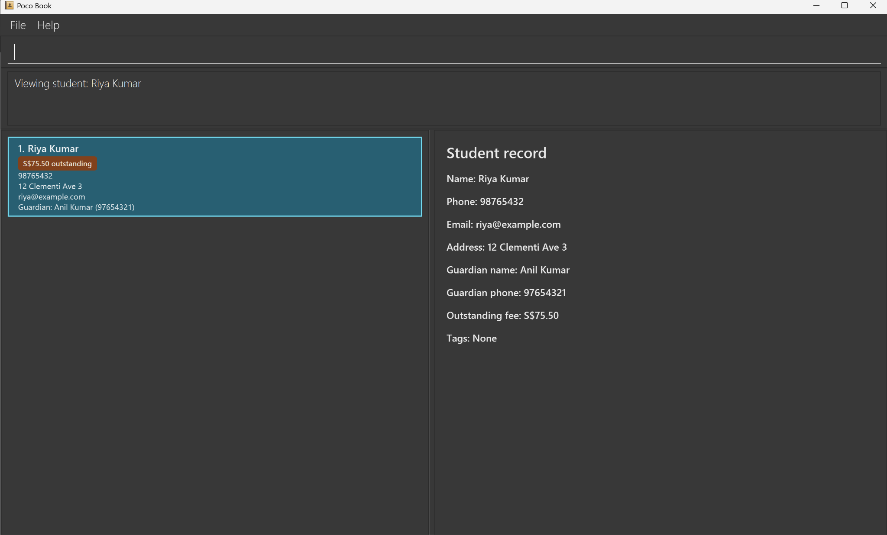
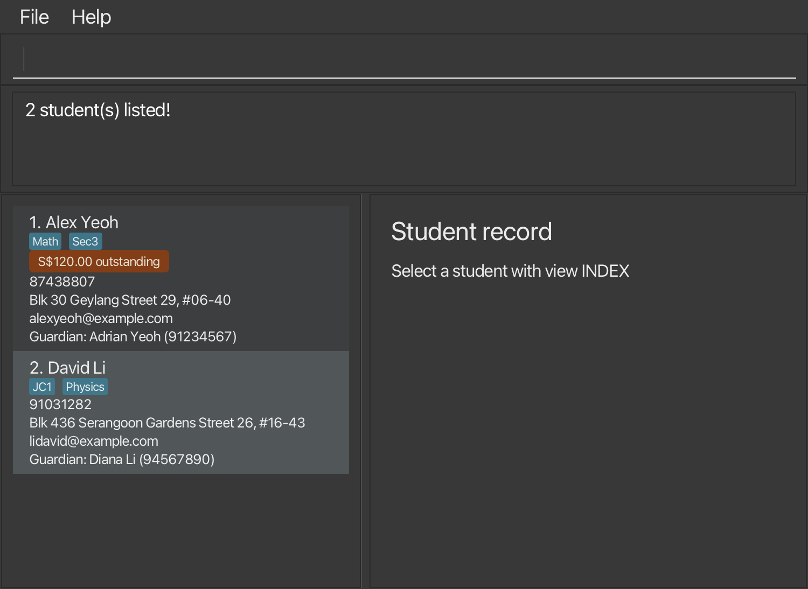

Poco Book is a **desktop application for independent tutors to manage students, guardian contacts, and outstanding fees, optimized for use through a Command Line Interface (CLI)** while retaining the benefits of a Graphical User Interface (GUI). If you type quickly, Poco Book can help you manage student records faster than traditional GUI applications.

* Table of Contents
{:toc}

--------------------------------------------------------------------------------------------------------------------

## Quick start

1. Ensure that Java `25` or later is installed on your computer. 
   **Mac users:** Ensure you have the precise JDK version prescribed [here](https://se-education.org/guides/tutorials/javaInstallationMac.html).

1. Download the latest `.jar` file from [here](https://github.com/AY2627S1-CS2103T-F09-2a/tp/releases).

1. Copy the file to the folder you want to use as the _home folder_ for Poco Book.

1. Open a terminal, `cd` to the folder containing the JAR file, and run `java -jar addressbook.jar`. 
   A GUI similar to the one below should appear in a few seconds. Note how the app contains some sample data. 
   

1. Type a command in the command box and press Enter to execute it. For example, type **`help`** and press Enter to open the help window. 
   Some example commands you can try:

   * `list` : Lists all students.

   * `add n/John Doe g/Jane Doe gp/98765432 e/johnd@example.com a/John street, block 123, #01-01` : Adds a student named `John Doe`, with guardian `Jane Doe`, to Poco Book.

   * `delete 3` : Deletes the 3rd student shown in the current list, after you press Y to confirm.

   * `clear` : Deletes all students.

   * `exit` : Exits the app.

1. Refer to the [Features](#features) section below for details of each command.

--------------------------------------------------------------------------------------------------------------------

## Features

**:information_source: Notes about the command format:** 

* Words in `UPPER_CASE` are the parameters to be supplied by the user. 
  For example, in `add n/NAME`, replace `NAME` with a value such as `John Doe`.

* Items in square brackets are optional. 
  For example, `n/NAME [t/TAG]` can be used as `n/John Doe t/friend` or as `n/John Doe`.

* Items followed by `…`​ can appear zero or more times. 
  For example, `[t/TAG]…​` may be omitted, or written as `t/friend` or `t/friend t/family`.

* Parameters can be in any order. 
  For example, if the command specifies `n/NAME p/PHONE`, `p/PHONE n/NAME` is also acceptable.

* For `delete`, `edit`, `view`, and `setoutstanding`, `INDEX` uses ASCII digits without leading zeros, such as `1` or `12`. Leading zeros (`01`), signs (`+1`), decimals, and extra index tokens produce an invalid-command-format message. A positive index larger than `2147483647` produces `The student index provided is invalid.` No record or current list is changed when the index is rejected.

* Extraneous parameters for commands that take no parameters, such as `list`, `exit`, and `clear`, are ignored. 
  For example, `list 123` is interpreted as `list`. `help` accepts an optional command word and rejects unknown targets or extra arguments.

* If you are using a PDF version of this document, be careful when copying and pasting commands that span multiple lines as space characters surrounding line-breaks may be omitted when copied over to the application.

### Viewing help: `help`

Plain `help` opens the existing help window with the online guide link.

Type `help COMMAND` to read a command’s purpose, syntax and example in the result area without leaving the app.
For example, `help paid` explains how to clear a displayed student’s full outstanding fee; it does not record a payment.

Format: `help [COMMAND]`

* Use one exact, lower-case command word: `add`, `clear`, `delete`, `edit`, `exit`, `fees`, `feesummary`, `find`, `findguardian`, `help`, `list`, `paid`, `setoutstanding`, or `view`.
* `help unknown` and `help paid 1` report an error and list the available command words.
* Long help instructions wrap in the result area; scroll vertically to read the remaining lines.
* Help leaves student records, the displayed list and selection unchanged and does not save data.
* `help clear` and `help exit` show instructions only; they do not clear data or close the app.

### Adding a student: `add`

Adds a student to the address book with their required guardian contact and optional personal contact or outstanding fee details.

Format: `add n/NAME g/GUARDIAN_NAME gp/GUARDIAN_PHONE [p/PHONE] [e/EMAIL] [a/ADDRESS] [f/AMOUNT]`

* `n/NAME`, `g/GUARDIAN_NAME`, and `gp/GUARDIAN_PHONE` are required; `p/PHONE`, `e/EMAIL`, `a/ADDRESS`, and `f/AMOUNT` are optional.
* Each prefix may appear at most once in an `add` command.
* `ADDRESS` may contain text such as `c/o`, `Blk A/B`, or `N/A`. Other parameters must not contain unrecognised prefixes such as `t/`.
* `PHONE` and `GUARDIAN_PHONE` must be 8-digit Singapore numbers starting with `6`, `8`, or `9` (spaces and hyphens between digits are allowed and removed when stored).
* `AMOUNT`, if provided, must be a positive amount between `0.01` and `99999.99` with up to 2 decimal places (and is stored to 2 decimal places).
* Two students are considered duplicates if they share the same normalized student name (case-insensitive, with consecutive spaces collapsed) and the same normalized guardian phone number.

Examples:
* `add n/Alex Tan g/Mei Tan gp/92345678`
* `add n/Riya Kumar g/Anil Kumar gp/97654321 p/98765432 e/riya@example.com a/12 Clementi Ave 3 f/75.50`

### Listing all students: `list`

Shows a list of all students in the address book.

Each student card shows the student's guardian contact as `Guardian: GUARDIAN_NAME (GUARDIAN_PHONE)`, together with any provided student phone, address, email, and tags.
Students with an outstanding fee also display an `S$AMOUNT outstanding` label on their cards, with the amount shown to two decimal places; students without an outstanding fee do not display this label. The same card details appear in `find` and `fees` results.

Format: `list`

### Listing students with outstanding fees: `fees`

Format: `fees [min/AMOUNT]`

Shows students with an outstanding fee, in stored order, with new displayed indexes.
The result states `N student(s) with outstanding fees.` An empty result is successful.

* Plain `fees` shows all students with a positive outstanding fee.
* `fees min/100` shows students owing at least S$100.00, including exactly S$100.00.
* The minimum must be from `0` to `99999.99`, with at most two decimal places and no sign or exponent.
* `fees min/0` still excludes students without an outstanding fee.
* Missing or invalid amounts, duplicate `min/` prefixes, unknown prefixes and extra arguments are rejected.
* The filter remains active when fees change. A student whose fee falls below the minimum disappears from the list.
* The command does not change or save records. Use `list` to restore all students.

### Finding students by guardian: `findguardian`

Format: `findguardian KEYWORD [MORE_KEYWORDS]…​`

* Matches whole guardian-name words without regard to case, or an exact guardian phone number.
* Phone keywords accept hyphens between digits, such as `9234-5678`; a phone containing spaces must be typed without spaces so it remains one keyword.
* Multiple keywords use OR matching. Partial name words and partial phone numbers do not match.
* Searches all stored students, replaces the current filter and preserves stored order. Shared guardians can return multiple students.
* Matching students are re-indexed from 1. Zero matches is a successful empty result.
* Missing keywords, unsupported punctuation and prefix-style input such as `g/Mei` are rejected.
* The command preserves records and the saved data file. Use `list` to restore all students.

Examples: `findguardian Mei`, `findguardian 92345678`, `findguardian Mei 9234-5678`.

### Totalling all outstanding fees: `feesummary`

Format: `feesummary`

Shows how many students owe fees and the exact total they owe, counting **every stored student**, even when the displayed list is filtered by `find` or `fees`.
The feedback reads `Across all stored students: N student(s) owe a total of S$AMOUNT. Displayed list unchanged.` with exactly two decimal places, so a book with no outstanding fees shows `Across all stored students: 0 student(s) owe a total of S$0.00. Displayed list unchanged.`
The total is the sum of all individual amounts and can therefore be larger than the S$99999.99 per-student maximum.

* This command takes no arguments; extra text produces an invalid-command-format message.
* The displayed list, the selected student and the stored data are unchanged. `feesummary` does not save anything.

Examples: `feesummary` in a book where two students owe S$180.00 and S$75.50 shows `Across all stored students: 2 student(s) owe a total of S$255.50. Displayed list unchanged.`

### Setting or clearing an outstanding fee: `setoutstanding`

Format: `setoutstanding INDEX AMOUNT`

* `INDEX` identifies a student in the current displayed list, starting from 1. Signs and leading zeros are rejected.
* `AMOUNT` replaces the full outstanding fee. Use a value from `0.01` to `99999.99`, with at most two decimal places.
* Use `0` to clear the fee. A student whose fee is cleared disappears from a `fees` result.
* Feedback shows `Set outstanding fee for NAME: S$AMOUNT`, with exactly two decimal places, including
  `S$0.00` when clearing a fee. Clearing an already-cleared fee succeeds with the same `S$0.00` feedback.
* Other student details and the current filter are preserved. Invalid input leaves records and the list unchanged.
* Successful changes are saved automatically. If a save error is reported, Poco Book still shows the new fee. The fee is saved the next time Poco Book saves successfully, such as after your next change, and is lost if you close Poco Book before then.

Examples: `setoutstanding 1 150.50`, `setoutstanding 1 0`.

### Recording a full payment: `paid`

Format: `paid INDEX`

Marks the outstanding fee of the student at `INDEX` in the **currently displayed list** as fully paid and reports how much was cleared.
The feedback reads `Marked outstanding fee as paid for NAME: S$AMOUNT`

* A typical flow is `fees` to see who owes money, then `paid INDEX` for the student who paid.
* `INDEX` refers to the displayed list, so run `list` or `fees` again if the list has changed since you last looked. Signs, leading zeros, zero, omitted and out-of-range indexes are rejected.
* A student with no outstanding fee is rejected with `This student has no outstanding fee to mark as paid: NAME`; `setoutstanding INDEX 0` remains available for clearing a fee explicitly.
* Every other detail of the student, and the active filter, is preserved. A student disappears from a `fees` result once their fee is cleared, and the remaining indexes shift up; in a `find` result the student stays visible if they still match.
* Rejected input changes neither the data nor the displayed list. A successful payment is saved automatically. If a save error is reported, Poco Book still shows the student as paid. The payment is saved the next time Poco Book saves successfully, such as after your next change, and is lost if you close Poco Book before then.

Examples: `paid 1`, `paid 2`.

### Editing a student: `edit`

Edits an existing student in the address book.

Format: `edit INDEX [n/NAME] [p/PHONE] [e/EMAIL] [a/ADDRESS] [g/GUARDIAN_NAME] [gp/GUARDIAN_PHONE] [t/TAG]…​`

* Edits the student at the specified `INDEX`. The index refers to the index number shown in the displayed student list. The index **must be a positive integer** 1, 2, 3, …​
* At least one of the optional fields must be provided.
* Existing values will be updated to the input values.
* When editing tags, all of the student's existing tags are removed; adding tags is not cumulative.
* To remove all of a student's tags, enter `t/` without a tag after it.
* Use `g/` and/or `gp/` to change guardian details. Omitted fields keep their existing values; guardian fields cannot be blank or cleared. Duplicate guardian prefixes are rejected.
* Outstanding fees cannot be changed with `edit`; `f/` is rejected. Use `setoutstanding` to change a fee.
* A successful edit returns to the full student list.

Examples:
* `edit 1 g/Mei Tan gp/92345678` Updates the guardian contact while preserving other fields.
* `edit 1 p/91234567 e/johndoe@example.com` Edits the phone number and email address of the 1st student to be `91234567` and `johndoe@example.com` respectively.
* `edit 2 n/Betsy Crower t/` Edits the name of the 2nd student to be `Betsy Crower` and clears all existing tags.

### Locating students by name: `find`

Finds students whose names contain any of the given keywords.

Format: `find KEYWORD [MORE_KEYWORDS]`

* The search is case-insensitive; for example, `hans` matches `Hans`.
* Keyword order does not matter; for example, `Hans Bo` matches `Bo Hans`.
* The search considers only student names. Guardian details, contact details and fees are not searched.
* Only full words match; for example, `Han` does not match `Hans`.
* Punctuation at the start or end of a name word is ignored; for example, `Tan` matches `Wei Ming Tan.` and `Junior` matches `Ali (Junior)`.
* Each keyword must use only characters that can appear in a name, so `find Alex 2` is accepted but `find @@@` shows an error and keeps the current list.
* Students matching at least one keyword are returned (an `OR` search); for example, `Hans Bo` returns `Hans Gruber` and `Bo Yang`.

Examples:
* `find John` returns `john` and `John Doe`
* `find alex david` returns `Alex Yeoh`, `David Li` 
  

### Viewing a student's complete record: `view`

Shows the selected student's full record beside the displayed list.

Format: `view INDEX`

* `INDEX` refers to the current displayed list, including results from `find`.
* The record shows the student's name, phone, email, address, guardian name, guardian phone, outstanding fee, and tags. Missing student contact details show `Not provided` (for example, `Phone: Not provided`). An outstanding fee shows as `Outstanding fee: S$AMOUNT` to two decimal places; if there is none, it shows `Outstanding fee: None`.
* The selected list card is highlighted. The result message names the student being viewed.
* Viewing does not change the displayed list or saved data. An invalid index leaves the previous selection unchanged.
* If a later search still includes the selected student, the selection stays on that student. If the search excludes them, the selection and details pane clear.
* If you update the viewed student with `edit` or `setoutstanding`, the details pane shows the updated record while the student remains in the displayed list. Clearing their fee from a `fees` result clears the selection.

Example:
* `list` followed by `view 2` shows the second student's record.

### Deleting a student: `delete`

Deletes the specified student from Poco Book, after you confirm the deletion.

Format: `delete INDEX`

* Deletes the student at the specified `INDEX`.
* The index refers to the index number shown in the displayed student list, which may be the results of `find` or `fees`.
* The index **must be a positive integer** 1, 2, 3, …​
* Before deleting, Poco Book opens a confirmation dialog showing the student's name, phone, guardian name and guardian
  phone.
  Check that this is the student you want to delete, then:
  * Press **Y** (or click **Delete (Y)**) to delete the student. Poco Book saves the change and shows the deleted
    student's details.
  * Press **N** (or click **Cancel (N)**) to keep the student. Pressing Esc or closing the dialog also keeps the
    student. Poco Book shows `Deletion cancelled. No student was deleted.` The same students stay displayed, and the
    selected student stays selected.
* All other keys, including Enter and Space, are ignored while the dialog is open, so pressing Enter again by
  mistake cannot answer it. Y or N pressed together with Control, Alt or Command is ignored too. Answer the dialog
  before typing your next command: a Y or N that you type is taken as the answer.
* If the student still owes a fee, the dialog shows a warning icon and a red banner with the amount, such as
  `This student still owes S$450.00. Deleting them also deletes this unpaid fee.` You can still delete the student.
* If the index is invalid, Poco Book shows an error message instead of the dialog, and no student is deleted.

:exclamation: **Caution:**
A deleted student cannot be restored. Their record, including any outstanding fee, is removed.

Examples:
* `list` followed by `delete 2` asks you to confirm deleting the 2nd student in the full list.
  With the sample data, the dialog shows `Bernice Yu`, phone `99272758`, guardian `Betty Yu` and guardian phone
  `82345678`.
  Press Y to delete her, or N to keep her.
* `fees` followed by `delete 2` asks you to confirm deleting the 2nd student who owes a fee.
  With the sample data, this is `Charlotte Oliveiro`, and the dialog warns that she still owes `S$450.00`.

### Clearing all entries: `clear`

Clears all entries from the address book.

Format: `clear`

### Exiting the program: `exit`

Exits the program.

Format: `exit`

### Saving the data

Poco Book saves student data automatically. You do not need to save manually.

### Editing the data file

Poco Book data is saved automatically as a JSON file `[JAR file location]/data/addressbook.json`. Advanced users are welcome to update data directly by editing that data file.

:exclamation: **Caution:**
If an edit makes the data file invalid, Poco Book starts with an empty address book next time. The invalid file stays on disk until a command that changes data, such as `add`, overwrites it. Commands that only display data, such as `list`, `find`, `fees`, `view`, `help`, and `exit`, do not save. Back up the file before editing it. 
Furthermore, certain edits can cause Poco Book to behave in unexpected ways (e.g., if a value entered is outside of the acceptable range). Therefore, edit the data file only if you are confident that you can update it correctly.

### Archiving data files `[coming in v2.0]`

_Details coming soon ..._

--------------------------------------------------------------------------------------------------------------------

## FAQ

**Q**: How do I transfer my data to another computer? 
**A**: Install the app on the other computer and overwrite the data file it creates with the data file from your previous Poco Book home folder.

--------------------------------------------------------------------------------------------------------------------

## Known issues

1. **When using multiple screens**, if you move the application to a secondary screen, and later switch to using only the primary screen, the GUI will open off-screen. The remedy is to delete the `preferences.json` file created by the application before running the application again.
2. **If you minimize the Help Window** and then run the `help` command (or use the `Help` menu, or the keyboard shortcut `F1`) again, the original Help Window will remain minimized, and no new Help Window will appear. The remedy is to manually restore the minimized Help Window.

--------------------------------------------------------------------------------------------------------------------

## Command summary

Action | Format, Examples
--------|------------------
**Add** | `add n/NAME g/GUARDIAN_NAME gp/GUARDIAN_PHONE [p/PHONE] [e/EMAIL] [a/ADDRESS] [f/AMOUNT]`   e.g., `add n/Riya Kumar g/Anil Kumar gp/97654321 p/98765432 e/riya@example.com a/12 Clementi Ave 3 f/75.50`
**Clear** | `clear`
**Delete** | `delete INDEX`, then press Y to confirm or N to cancel  e.g., `delete 3`
**Edit** | `edit INDEX [n/NAME] [p/PHONE] [e/EMAIL] [a/ADDRESS] [g/GUARDIAN_NAME] [gp/GUARDIAN_PHONE] [t/TAG]…​`  e.g., `edit 2 n/James Lee e/jameslee@example.com`
**Find** | `find KEYWORD [MORE_KEYWORDS]`  e.g., `find James Jake`
**Find by guardian** | `findguardian KEYWORD [MORE_KEYWORDS]…​`  e.g., `findguardian Mei 92345678`
**List** | `list`
**View** | `view INDEX`  e.g., `view 1`
**Fees** | `fees [min/AMOUNT]`  e.g., `fees min/100`
**Fee summary** | `feesummary`
**Set outstanding fee** | `setoutstanding INDEX AMOUNT`  e.g., `setoutstanding 1 150.50`; `setoutstanding 1 0` clears it
**Record payment** | `paid INDEX`  e.g., `paid 1`
**Help** | `help [COMMAND]`  e.g., `help paid`
**Exit** | `exit`
