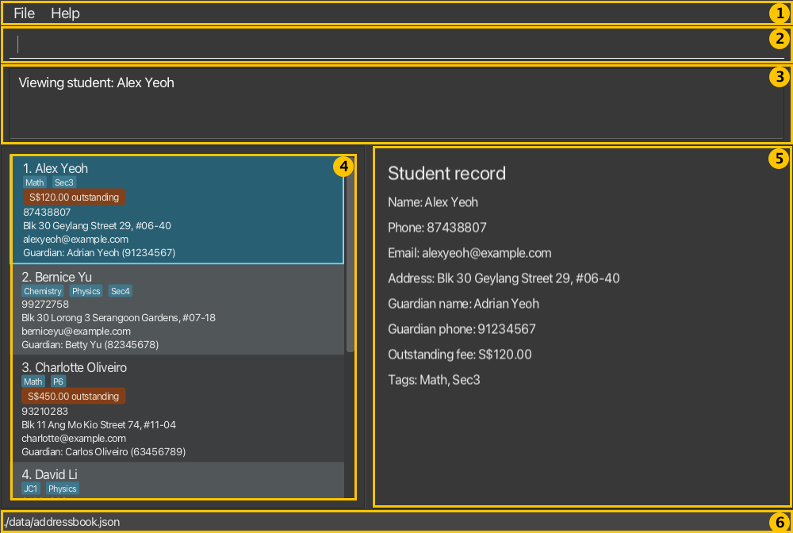
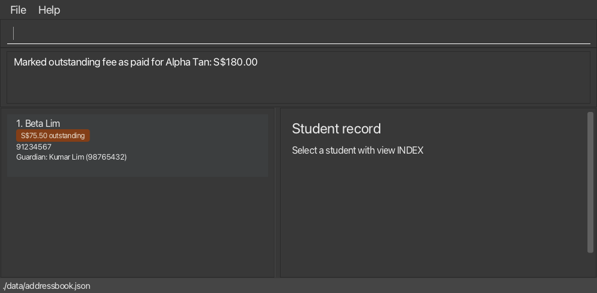

Poco Book is a **desktop application for independent tutors to manage students, guardian contacts, and outstanding fees, optimized for use through a Command Line Interface (CLI)** while retaining the benefits of a Graphical User Interface (GUI). If you type quickly, Poco Book can help you manage student records faster than traditional GUI applications.

* Table of Contents
{:toc}

--------------------------------------------------------------------------------------------------------------------

## Quick start

1. Ensure that Java `25` or later is installed on your computer. 
   **Mac users:** Ensure you have the precise JDK version prescribed [here](https://se-education.org/guides/tutorials/javaInstallationMac.html).

1. Download the latest `.jar` file from [here](https://github.com/AY2627S1-CS2103T-F09-2a/tp/releases).

1. Copy the file to the folder you want to use as the _home folder_ for Poco Book.

   **Use only one running Poco Book instance per home folder.** Two instances do not synchronize changes to
   `data/addressbook.json`; even if they save at different times, one can overwrite records saved by the other.
   Running multiple instances against the same folder is unsupported and may result in lost changes.

1. Open a terminal, `cd` to the folder containing the JAR file, and run `java -jar addressbook.jar`. 
   A GUI similar to the one below should appear in a few seconds. Note how the app contains some sample data. 
   

1. Type a command in the command box and press Enter to execute it. For example, type **`help`** and press Enter to open the help window. 
   Some example commands you can try:

   * `list` : Lists all students.

   * `add n/John Doe g/Jane Doe gp/98765432 e/johnd@example.com a/John street, block 123, #01-01` : Adds a student named `John Doe`, with guardian `Jane Doe`, to Poco Book.

   * `delete 3` : Deletes the 3rd student shown in the current list, after you press Y to confirm.

   * `clear` : Deletes all students.

   * `exit` : Exits the app.

1. New to Poco Book? Try the [five-minute walkthrough](#five-minute-walkthrough) next.

1. Refer to the [Features](#features) section below for details of each command.

--------------------------------------------------------------------------------------------------------------------

## Five-minute walkthrough

### The main window

1. **Menu bar:** `File` → `Exit` closes Poco Book, and `Help` → `Help` (or `F1`) opens the help window.
1. **Command box:** type a command here and press Enter.
1. **Result display:** shows the result of your last command, or an error message explaining what to fix.
1. **Student list:** the students currently displayed, each with an index, tags, any outstanding fee, contact details and guardian. Commands such as `view`, `paid` and `delete` use the index shown here.
1. **Student record:** the full details of the student selected with `view INDEX`.
1. **Status bar:** the location of the data file Poco Book saves to.

### Walkthrough

This walkthrough takes you through a typical first session: adding two students, finding a guardian, checking who owes fees, recording a payment, and confirming that Poco Book keeps your changes after a restart. It takes about five minutes.

:exclamation: **Caution:**
Do this walkthrough in a **new, empty folder**, not the folder where you keep your real student records. Step 1 deletes everything in the address book, which is safe only in a new folder.

1. **Start with an empty book.** Copy `addressbook.jar` into a new folder, such as `poco-walkthrough`, and launch it from a terminal in that folder with `java -jar addressbook.jar`. Poco Book starts with six sample students. Type `clear` and press Enter. 
   Poco Book shows `Address book has been cleared!` and the list is empty.

1. **Add two students.** Type each command and press Enter:
   * `add n/Alpha Tan g/Mei Tan gp/92345678 e/alpha@example.com f/180`
   * `add n/Beta Lim g/Kumar Lim gp/98765432 p/91234567 f/75.50`

   After each command, Poco Book shows `New student added:` with the student's details. The list now shows `1. Alpha Tan`, owing `S$180.00`, and `2. Beta Lim`, owing `S$75.50`. Student details you did not give show as `Not provided`.

1. **Find a student by their guardian.** Type `findguardian Mei`. 
   Poco Book shows `1 student(s) listed!` and the list shows only Alpha Tan, at index `1`.

1. **View the complete record.** Type `view 1`. 
   Poco Book shows `Viewing student: Alpha Tan`, and the details pane shows all of Alpha's details, including `Guardian name: Mei Tan`, `Guardian phone: 92345678` and `Outstanding fee: S$180.00`.

1. **List who owes fees.** Type `fees`. 
   Poco Book shows `2 student(s) with outstanding fees.` Then type `fees min/100`. Poco Book shows `1 student(s) with outstanding fees.` and only Alpha Tan is listed, because Beta owes less than S$100.00.

1. **Total all fees.** Type `find Beta`, then `feesummary`. 
   The list shows only Beta, but Poco Book shows `Across all stored students: 2 student(s) owe a total of S$255.50. Displayed list unchanged.` `feesummary` always counts **every** stored student, while `find`, `findguardian` and `fees` only change which students are displayed. Each of those three commands replaces the previous filter instead of narrowing it.

1. **Record a payment.** Type `fees` again. Check that index `1` is **Alpha Tan**, then type `paid 1`. 
   Poco Book shows `Marked outstanding fee as paid for Alpha Tan: S$180.00`. Alpha disappears from the `fees` list, so Beta Lim moves up to index `1`.

   

   
:bulb: **Tip:**
   Indexes always refer to the list currently on screen, and they change when the list changes. Check the name next to an index before every `paid`, `setoutstanding`, `edit` or `delete`.
   

1. **Check the new total.** Type `feesummary`. 
   Poco Book shows `Across all stored students: 1 student(s) owe a total of S$75.50. Displayed list unchanged.`

1. **Restart and check your data.** Type `exit`. Launch Poco Book again from the same folder with `java -jar addressbook.jar`, then type `list` and `view 1`. 
   Both students are still there. Alpha Tan shows `Outstanding fee: None` and Beta Lim still owes `S$75.50`. Poco Book saved every change automatically.

If Poco Book reports a save error during the walkthrough, your change is still shown but has not been saved yet. Make sure the folder is writable, then make another change; Poco Book saves everything the next time a save succeeds. Changes are lost if you close Poco Book before then.

When you are done, you can delete the walkthrough folder. To keep using Poco Book, launch it from the folder you want to use for your real records. See [Features](#features) for every command.

--------------------------------------------------------------------------------------------------------------------

## Features

**:information_source: Notes about the command format:** 

* Command words can be typed in any letter case. 
  For example, `list`, `List` and `LIST` all list every student, and `DELETE 2` asks for the same confirmation as `delete 2`. Prefixes such as `n/` and `gp/` must still be typed in lower case. 
  If the command word is not recognised, such as `lsit`, Poco Book shows that word, suggests `help COMMAND` and lists the available command words. Nothing is changed.

* Words in `UPPER_CASE` are the parameters to be supplied by the user. 
  For example, in `add n/NAME`, replace `NAME` with a value such as `John Doe`.

* Items in square brackets are optional. 
  For example, `n/NAME [t/TAG]` can be used as `n/John Doe t/friend` or as `n/John Doe`.

* Items followed by `…`​ can appear zero or more times. 
  For example, `[t/TAG]…​` may be omitted, or written as `t/friend` or `t/friend t/family`.

* Parameters with a prefix, such as `n/NAME`, can be in any order. 
  For example, if the command specifies `n/NAME p/PHONE`, `p/PHONE n/NAME` is also acceptable.
  Parameters without a prefix must come before all prefixed parameters (for example, `edit 1 n/Alex`) and stay in the documented order; for example, `setoutstanding 1 75.50` works but `setoutstanding 75.50 1` is rejected.

* For `delete`, `edit`, `view`, and `setoutstanding`, `INDEX` uses ASCII digits without leading zeros, such as `1` or `12`. Leading zeros (`01`), signs (`+1`), decimals, and extra index tokens produce an invalid-command-format message. A positive index larger than `2147483647` produces `The student index provided is invalid.` No record or current list is changed when the index is rejected.

* Only `list`, `exit`, and `clear` ignore any text typed after the command word. 
  For example, `list 123` is interpreted as `list`, and `clear 123` still deletes all students.
  `feesummary` takes no parameters and rejects extra text, such as `feesummary 1`. `help` accepts one optional command word and rejects unknown command words or extra text, such as `help paid 1`.

* If you are using a PDF version of this document, be careful when copying and pasting commands that span multiple lines as space characters surrounding line-breaks may be omitted when copied over to the application.

### Viewing help: `help`

Plain `help` opens the existing help window with the online guide link.

The image shows the help window's contents (without the operating system's window frame).

Type `help COMMAND` to read a command’s purpose, syntax and example in the result area without leaving the app.
For example, `help paid` explains how to clear a displayed student’s full outstanding fee; it does not record a payment.

Format: `help [COMMAND]`

* Use one command word, in any letter case: `add`, `clear`, `delete`, `edit`, `exit`, `fees`, `feesummary`, `find`, `findguardian`, `help`, `list`, `paid`, `setoutstanding`, or `view`. For example, `help PAID` shows the same instructions as `help paid`.
* `help lsit` shows `Unknown command: "lsit".` and lists the available command words. `help paid 1` asks you to type only one command word after `help`.
* Long help instructions wrap in the result area; scroll vertically to read the remaining lines.
* Help leaves student records, the displayed list and selection unchanged and does not save data.
* `help clear` and `help exit` show instructions only; they do not clear data or close the app.

### Adding a student: `add`

Adds a student to Poco Book with their required guardian contact and optional personal contact or outstanding fee details.

Format: `add n/NAME g/GUARDIAN_NAME gp/GUARDIAN_PHONE [p/PHONE] [e/EMAIL] [a/ADDRESS] [f/AMOUNT] [t/TAG]…​`

* `n/NAME`, `g/GUARDIAN_NAME`, and `gp/GUARDIAN_PHONE` are required; `p/PHONE`, `e/EMAIL`, `a/ADDRESS`, `f/AMOUNT`, and `t/TAG` are optional.
* If any required parameters are missing, the error names all of them, such as `Missing required parameter(s): g/, gp/.`
* `t/TAG` may be repeated to give the student several tags. Each tag may contain only ASCII letters and digits, with no spaces or punctuation, as for `edit`. Every other prefix may appear at most once in an `add` command.
* `ADDRESS` may contain text such as `c/o`, `Blk A/B`, or `N/A`, but a `t/` in it starts a tag. Other parameters must not contain unrecognised prefixes such as `x/`.
* `NAME` and `GUARDIAN_NAME` must be 1 to 70 characters long and contain at least one letter. They may use letters (including non-English letters such as `é` or `李`), digits, spaces, apostrophes, hyphens, periods and parentheses. Extra spaces are removed before the length is counted.
* `ADDRESS`, if provided, must be 1 to 150 characters long and fit on one line.
* `EMAIL`, if provided, must be at most 254 characters long, with at most 64 characters before `@`, and must end in a domain such as `example.com` (the last part must be at least 2 letters).
* `PHONE` and `GUARDIAN_PHONE` must be 8-digit Singapore numbers starting with `6`, `8`, or `9`. They may start with the country code `+65`, e.g. `+65 9123 4567`. Spaces, hyphens and the country code are removed when stored.
* `AMOUNT`, if provided, must be a positive amount between `0.01` and `99999.99` with up to 2 decimal places (and is stored to 2 decimal places).
  Enter the amount as a plain number, without `S$`, `$` or commas; `f/` is only the field prefix before the number.
* Two students are considered duplicates if they share the same normalized student name (case-insensitive, with consecutive spaces collapsed) and the same normalized guardian phone number. Adding or editing a student into a duplicate is rejected with a message explaining this rule.
* `NAME` and `GUARDIAN_NAME` may include `S/O` or `D/O` as a separate word, such as `Ravi S/O Raj`. Separate the marker from adjacent text with spaces; for example, use `Tan ( S/O Lim)` rather than `Tan (S/O Lim)`. The marker must come between names, so `S/O Raj`, `Ravi S/O` and `S/O` alone are not valid names. Other slashes are not allowed in names.
* Names accept only the straight apostrophe (`'`) and the ASCII hyphen (`-`). Curly apostrophes (`’`) and other dashes (`‐`, `–`), which some keyboards and copied text produce, are rejected; retype them as `'` or `-`.
* In `EMAIL`, the part before `@` may use only ASCII letters (A-Z, a-z), digits, `.`, `_`, `+` and `-`. Addresses with other characters, such as an apostrophe (`o'connor@example.com`), are not supported.

Examples:
* `add n/Alex Tan g/Mei Tan gp/92345678`
* `add n/Riya Kumar g/Anil Kumar gp/97654321 p/98765432 e/riya@example.com a/12 Clementi Ave 3 f/75.50`
* `add n/Wei Ling g/Tan Mei gp/91234567 t/Math t/Sec3`: Adds a student with the tags `Math` and `Sec3`.
* `add n/José O'Neil-Tan g/Maria O'Neil gp/91112222` is accepted: accented letters, apostrophes and hyphens are allowed in names.
* `add n/Tom & Jerry g/Mei Tan gp/92345678` is rejected because `&` is not allowed in names.
* `add n/Alex Tan g/Mei Tan gp/92345678 e/alex@example` is rejected because the email has no domain ending such as `.com`.

### Listing all students: `list`

Shows a list of all students in Poco Book.

Each student card shows the student's guardian contact as `Guardian: GUARDIAN_NAME (GUARDIAN_PHONE)`, together with any provided student phone, address, email, and tags.
Students with an outstanding fee also display an `S$AMOUNT outstanding` label on their cards, with the amount shown to two decimal places; students without an outstanding fee do not display this label. The same card details appear in `find` and `fees` results.

Format: `list`

### Listing students with outstanding fees: `fees`

Format: `fees [min/AMOUNT]`

Shows students with an outstanding fee, in stored order, with new displayed indexes.
The result states `N student(s) with outstanding fees.` An empty result is successful.

* Plain `fees` shows all students with a positive outstanding fee.
* `fees min/100` shows students owing at least S$100.00, including exactly S$100.00.
* The minimum must be from `0` to `99999.99`, with at most two decimal places and no sign or exponent.
* `fees min/0` still excludes students without an outstanding fee.
* Missing or invalid amounts, duplicate `min/` prefixes, unknown prefixes and extra arguments are rejected, with a message naming the problem; for example, `fees min/abc` reports `Invalid minimum amount: abc.`
* The filter remains active when fees change. A student whose fee falls below the minimum disappears from the list.
* The command does not change or save records. Use `list` to restore all students.

### Finding students by guardian: `findguardian`

Format: `findguardian KEYWORD [MORE_KEYWORDS]…​`

* Matches whole guardian-name words without regard to case, or an exact guardian phone number.
* Phone keywords accept hyphens between digits and the country code `+65`, such as `9234-5678` or `+6592345678`; a phone containing spaces must be typed without spaces so it remains one keyword. For example, type `findguardian +6597654321` for the phone `+65 9765 4321`.
* Multiple keywords use OR matching. Partial name words and partial phone numbers do not match.
* Searches all stored students, replaces the current filter and preserves stored order. Shared guardians can return multiple students.
* Matching students are re-indexed from 1. Zero matches is a successful empty result.
* Missing keywords, unsupported punctuation and prefix-style input such as `g/Mei` are rejected.
* The command preserves records and the saved data file. Use `list` to restore all students.

Examples: `findguardian Mei`, `findguardian 92345678`, `findguardian Mei 9234-5678`.

### Totalling all outstanding fees: `feesummary`

Format: `feesummary`

Shows how many students owe fees and the exact total they owe, counting **every stored student**, even when the displayed list is filtered by `find` or `fees`.
The feedback reads `Across all stored students: N student(s) owe a total of S$AMOUNT. Displayed list unchanged.` with exactly two decimal places, so a book with no outstanding fees shows `Across all stored students: 0 student(s) owe a total of S$0.00. Displayed list unchanged.`
The total is the sum of all individual amounts and can therefore be larger than the S$99999.99 per-student maximum.

* This command takes no arguments; extra text produces an invalid-command-format message.
* The displayed list, the selected student and the stored data are unchanged. `feesummary` does not save anything.

Examples: `feesummary` in a book where two students owe S$180.00 and S$75.50 shows `Across all stored students: 2 student(s) owe a total of S$255.50. Displayed list unchanged.`

### Setting, adding to, or clearing an outstanding fee: `setoutstanding`

Format: `setoutstanding INDEX AMOUNT` or `setoutstanding INDEX +AMOUNT`

* `INDEX` identifies a student in the current displayed list, starting from 1. Signs and leading zeros are rejected.
* `AMOUNT` without a sign replaces the full outstanding fee. Use a value from `0.01` to `99999.99`, with at most two decimal places.
  Type a plain number without `S$`, `$`, commas or `f/`, e.g. `50` or `+50` rather than `S$50`.
* `+AMOUNT` adds to the fee that is already recorded, instead of replacing it. Use it when you charge the same student again before the earlier amount is settled, so you do not have to work out the new total yourself. The amount to add must be from `0.01` to `99999.99`, and `+0` is rejected.
* A student with no outstanding fee counts as owing `S$0.00`, so `setoutstanding 1 +50` on that student records `S$50.00`.
* If an addition would push the fee above `S$99999.99`, the command is rejected with a message naming the amount that was refused and the total it would have produced. Nothing is changed.
* Use `0` to clear the fee. A student whose fee is cleared disappears from a `fees` result.
* Feedback for a replacement or a clear shows `Set outstanding fee for NAME: S$AMOUNT`, with exactly two decimal places, including
  `S$0.00` when clearing a fee. Clearing an already-cleared fee succeeds with the same `S$0.00` feedback.
* Feedback for an addition shows the change, e.g. `Added S$50.00 to the outstanding fee for Alex Yeoh: S$120.00 -> S$170.00`.
* Other student details and the current filter are preserved. Invalid input leaves records and the list unchanged.
* Successful changes are saved automatically. If a save error is reported, Poco Book still shows the new fee. The fee is saved the next time Poco Book saves successfully, such as after your next change, and is lost if you close Poco Book before then.

Examples: `setoutstanding 1 150.50`, `setoutstanding 1 +50`, `setoutstanding 1 0`.

### Recording a full payment: `paid`

Format: `paid INDEX`

Marks the outstanding fee of the student at `INDEX` in the **currently displayed list** as fully paid and reports how much was cleared.
The feedback reads `Marked outstanding fee as paid for NAME: S$AMOUNT`

* A typical flow is `fees` to see who owes money, then `paid INDEX` for the student who paid.
* `INDEX` refers to the displayed list, so run `list` or `fees` again if the list has changed since you last looked. Signs, leading zeros, zero, omitted and out-of-range indexes are rejected.
* A student with no outstanding fee is rejected with `This student has no outstanding fee to mark as paid: NAME`; `setoutstanding INDEX 0` remains available for clearing a fee explicitly.
* Every other detail of the student, and the active filter, is preserved. A student disappears from a `fees` result once their fee is cleared, and the remaining indexes shift up; in a `find` result the student stays visible if they still match.
* Rejected input changes neither the data nor the displayed list. A successful payment is saved automatically. If a save error is reported, Poco Book still shows the student as paid. The payment is saved the next time Poco Book saves successfully, such as after your next change, and is lost if you close Poco Book before then.

Examples: `paid 1`, `paid 2`.

### Editing a student: `edit`

Edits an existing student in Poco Book.

Format: `edit INDEX [n/NAME] [p/PHONE] [e/EMAIL] [a/ADDRESS] [g/GUARDIAN_NAME] [gp/GUARDIAN_PHONE] [t/TAG]…​`

* Edits the student at the specified `INDEX`. The index refers to the index number shown in the displayed student list. The index **must be a positive integer** 1, 2, 3, …​
* At least one of the optional fields must be provided.
* Existing values will be updated to the input values.
* If every given value is the same as the student's current details, the edit is rejected with `No changes made: the student already has these details.` and nothing is saved. A change in capitalisation alone, such as `edit 1 g/mei tan` for a guardian saved as `Mei Tan`, counts as a change and is saved.
* When editing tags, all of the student's existing tags are removed; adding tags is not cumulative.
* A tag contains only ASCII letters (`A`–`Z`, `a`–`z`) and digits (`0`–`9`), with no spaces or punctuation.
  For example, `t/Math2` is accepted, while `t/数学` and `t/Máth` are rejected. Student and guardian names
  have separate character rules; their support for multilingual names does not extend to tags.
* To remove all of a student's tags, enter `t/` without a tag after it. `t/` cannot be combined with other tags, so `edit 1 t/ t/Math` is rejected.
* To remove a student's phone, email or address, enter `p/`, `e/` or `a/` with nothing after it. Omitting the prefix keeps the existing value.
* Tags are not case-sensitive. If you give the same tag twice in different cases, such as `t/Math t/math`, only the first is kept.
  When an older data file contains tags differing only in case (such as `Math` and `math`), they load as one tag. The next save stores only that single tag.
* Use `g/` and/or `gp/` to change guardian details. Omitted fields keep their existing values; guardian fields cannot be blank or cleared. Duplicate guardian prefixes are rejected.
* `edit` changes only the student at `INDEX`. If you change the guardian phone and other students (such as siblings) still have the old number, the result names them so you can edit them too.
* Outstanding fees cannot be changed with `edit`; `f/` is rejected. Use `setoutstanding` to change a fee.
* A successful edit returns to the full student list.

Examples:
* `edit 1 g/Mei Tan gp/92345678` Updates the guardian contact while preserving other fields.
* `edit 1 p/91234567 e/johndoe@example.com` Edits the phone number and email address of the 1st student to be `91234567` and `johndoe@example.com` respectively.
* `edit 2 n/Betsy Crower t/` Edits the name of the 2nd student to be `Betsy Crower` and clears all existing tags.
* `edit 1 p/ e/` Removes the phone number and email address of the 1st student.

### Locating students by name: `find`

Finds students whose names contain any of the given keywords.

Format: `find KEYWORD [MORE_KEYWORDS]`

* The search is case-insensitive; for example, `hans` matches `Hans`. Letters are compared one at a time, so a letter that capitalises to two letters is not matched by them; for example, `STRASSE` does not match `Straße`. The same rule applies when checking for duplicate students.
* Keyword order does not matter; for example, `Hans Bo` matches `Bo Hans`.
* The search considers only student names. Guardian details, contact details and fees are not searched.
* Only full words match; for example, `Han` does not match `Hans`.
* Punctuation at the start or end of a name word is ignored; for example, `Tan` matches `Wei Ming Tan.` and `Junior` matches `Ali (Junior)`.
* Each keyword must use only characters that can appear in a name, so `find Alex 2` is accepted but `find @@@` shows an error and keeps the current list.
* Students matching at least one keyword are returned (an `OR` search); for example, `Hans Bo` returns `Hans Gruber` and `Bo Yang`.

Examples:
* `find John` returns `john` and `John Doe`
* With the sample data, `find alex david` returns `Alex Yeoh` and `David Li`: 
  

### Viewing a student's complete record: `view`

Shows the selected student's full record beside the displayed list.

Format: `view INDEX`

* `INDEX` refers to the current displayed list, including results from `find`.
* The record shows the student's name, phone, email, address, guardian name, guardian phone, outstanding fee, and tags. Missing student contact details show `Not provided` (for example, `Phone: Not provided`). An outstanding fee shows as `Outstanding fee: S$AMOUNT` to two decimal places; if there is none, it shows `Outstanding fee: None`. Tags are listed in alphabetical order, ignoring case (for example, `Tags: aMath, biology, Chemistry`). Numbers in tags are not compared by value: tags are compared character by character, so `Sec10` comes before `Sec3`. If there are none, it shows `Tags: None`.
* The selected list card is highlighted. The result message names the student being viewed.
* A long tag is cut off with `...` on the student card so that it fits. The record shows the full tag.
* Viewing does not change the displayed list or saved data. An invalid index leaves the previous selection unchanged.
* If a later search still includes the selected student, the selection stays on that student. If the search excludes them, the selection and details pane clear.
* If you update the viewed student with `edit` or `setoutstanding`, the details pane shows the updated record while the student remains in the displayed list. Clearing their fee from a `fees` result clears the selection.

Example:
* `list` followed by `view 2` shows the second student's record.

### Deleting a student: `delete`

Deletes the specified student from Poco Book, after you confirm the deletion.

Format: `delete INDEX`

* Deletes the student at the specified `INDEX`.
* The index refers to the index number shown in the displayed student list, which may be the results of `find` or `fees`.
* The index **must be a positive integer** 1, 2, 3, …​
* Before deleting, Poco Book opens a confirmation dialog showing the student's name, phone, guardian name and guardian
  phone.
  Check that this is the student you want to delete, then:
  * Press **Y** (or click **Delete (Y)**) to delete the student. Poco Book saves the change and shows the deleted
    student's details.
  * Press **N** (or click **Cancel (N)**) to keep the student. Pressing Esc or closing the dialog also keeps the
    student. Poco Book shows `Deletion cancelled. No student was deleted.` The same students stay displayed, and the
    selected student stays selected.
* All other keys, including Enter and Space, are ignored while the dialog is open, so pressing Enter again by
  mistake cannot answer it. Y or N pressed together with Control, Alt or Command is ignored too. Answer the dialog
  before typing your next command: a Y or N that you type is taken as the answer.
* If the student still owes a fee, the dialog shows a warning icon and a red banner with the amount, such as
  `This student still owes S$450.00. Deleting them also deletes this unpaid fee.` You can still delete the student.
* If the index is invalid, Poco Book shows an error message instead of the dialog, and no student is deleted.

:exclamation: **Caution:**
A deleted student cannot be restored. Their record, including any outstanding fee, is removed.

Examples:
* `list` followed by `delete 2` asks you to confirm deleting the 2nd student in the full list.
  With the sample data, the dialog shows `Bernice Yu`, phone `99272758`, guardian `Betty Yu` and guardian phone
  `82345678`.
  Press Y to delete her, or N to keep her.
* `fees` followed by `delete 2` asks you to confirm deleting the 2nd student who owes a fee.
  With the sample data, this is `Charlotte Oliveiro`, and the dialog warns that she still owes `S$450.00`.

### Clearing all entries: `clear`

Clears all students from Poco Book.

Format: `clear`

**Caution:** `clear` immediately removes **every stored student**, including students hidden by a search and
their guardian contacts and outstanding fees. It does not ask for confirmation or offer undo; extra text after
`clear` does not limit what it removes. To keep a recoverable copy, close Poco Book and back up
`data/addressbook.json` before running `clear`, then reopen the app. If no data file exists yet, first make a
data-changing command so the current records are saved before backing them up.

### Exiting the program: `exit`

Exits the program.

Format: `exit`

### Saving the data

Poco Book saves student data automatically. You do not need to save manually.

Window size and position are remembered between launches. If the saved size is invalid, Poco Book uses its
default size. If the saved position is no longer on an available screen (for example, after disconnecting a
monitor), Poco Book recenters the window on an available screen.

If saving fails, for example because the disk is full, Poco Book shows an error, and the data file still holds the data from the last successful save. If Poco Book closes unexpectedly while saving, a file ending in `.tmp`, such as `addressbook.json.5784445305140543549.tmp`, may be left in the `data` folder or beside the JAR file. Poco Book does not use it, so you can delete it.

### Editing the data file

Poco Book data is saved automatically as a JSON file `[JAR file location]/data/addressbook.json`. Advanced users are welcome to update data directly by editing that data file.

:exclamation: **Caution:**
Close Poco Book and back up the file before editing it. Edits made while Poco Book is running are overwritten the next time it saves. 
The file must hold exactly one JSON object: only spaces or blank lines may follow that object's closing `}`, and a field cannot appear twice in the same object (for example, two `name` fields for one student). Otherwise, the file is invalid, even if its first part is correct. A student with a missing or misspelled `name`, `guardianName`, or `guardianPhone`, or with a value outside the limits in [Adding a student](#adding-a-student-add), such as an `outstandingFee` above `99999.99`, also makes the whole file invalid. 
If the file is invalid, Poco Book starts with no students next time, without any warning. It leaves the file unchanged until `add` or `clear` succeeds. Either command overwrites the file with the current list, so the students in the file are lost; `clear` does this even though the list is already empty. Commands that do not change data, such as `list`, `find`, `fees`, `view`, `help`, and `exit`, do not save. If the list is unexpectedly empty, close Poco Book and fix the file or restore your backup before entering anything else. 
Some mistakes do not make the file invalid, but still lose data. A misspelled optional field, such as `outstandingFees` for `outstandingFee`, is ignored, and its value is removed from the file at the next save. Save the file as UTF-8, not "UTF-8 with BOM": otherwise, the file may be invalid, or characters such as `é` in an address may be replaced with `�`.

### Archiving data files `[coming in v2.0]`

_Details coming soon ..._

--------------------------------------------------------------------------------------------------------------------

## FAQ

**Q**: How do I transfer my data to another computer? 
**A**: Copy `data/addressbook.json` from the folder containing your old Poco Book JAR to the same path beside
the JAR on the new computer. Close Poco Book on both computers first. Create the `data` folder on the new computer
if it does not exist; a fresh launch displays sample students in memory but does not create the data file until a
change is saved. If `data/addressbook.json` already exists at the destination, back it up before replacing it.
Relaunch Poco Book to load the transferred students, guardians, and outstanding fees.

**Q**: Can I edit the same home folder in two open windows? 
**A**: No. Using two running instances with one home folder is unsupported. Each keeps its own copy of the records
in memory, and saving from an instance with older data can overwrite newer saved changes. Close all instances and
reopen just one before editing that folder again; use a backup if changes have already been lost.

--------------------------------------------------------------------------------------------------------------------

## Known issues

1. **If you minimize the Help Window** and then run the `help` command (or use the `Help` menu, or the keyboard shortcut `F1`) again, the original Help Window will remain minimized, and no new Help Window will appear. The remedy is to manually restore the minimized Help Window.
2. **Names and emails with less common characters**, such as curly apostrophes (`’`), Unicode dashes or apostrophes in emails, are rejected, and letters such as `ß` are not matched with `SS` in `find` or duplicate checks. The remedy is to type the name with `'` and `-`, use an email without the unsupported characters, and search with the spelling stored in Poco Book.

--------------------------------------------------------------------------------------------------------------------

## Command summary

Action | Format, Examples
--------|------------------
**Add** | `add n/NAME g/GUARDIAN_NAME gp/GUARDIAN_PHONE [p/PHONE] [e/EMAIL] [a/ADDRESS] [f/AMOUNT] [t/TAG]…​`   e.g., `add n/Riya Kumar g/Anil Kumar gp/97654321 p/98765432 e/riya@example.com a/12 Clementi Ave 3 f/75.50 t/Math`
**Clear** | `clear`
**Delete** | `delete INDEX`, then press Y to confirm or N to cancel  e.g., `delete 3`
**Edit** | `edit INDEX [n/NAME] [p/PHONE] [e/EMAIL] [a/ADDRESS] [g/GUARDIAN_NAME] [gp/GUARDIAN_PHONE] [t/TAG]…​`  e.g., `edit 2 n/James Lee e/jameslee@example.com`
**Find** | `find KEYWORD [MORE_KEYWORDS]`  e.g., `find James Jake`
**Find by guardian** | `findguardian KEYWORD [MORE_KEYWORDS]…​`  e.g., `findguardian Mei 92345678`
**List** | `list`
**View** | `view INDEX`  e.g., `view 1`
**Fees** | `fees [min/AMOUNT]`  e.g., `fees min/100`
**Fee summary** | `feesummary`
**Set outstanding fee** | `setoutstanding INDEX AMOUNT`  e.g., `setoutstanding 1 150.50`; `setoutstanding 1 0` clears it `setoutstanding INDEX +AMOUNT` adds to the fee already recorded  e.g., `setoutstanding 1 +50`
**Record payment** | `paid INDEX`  e.g., `paid 1`
**Help** | `help [COMMAND]`  e.g., `help paid`
**Exit** | `exit`
