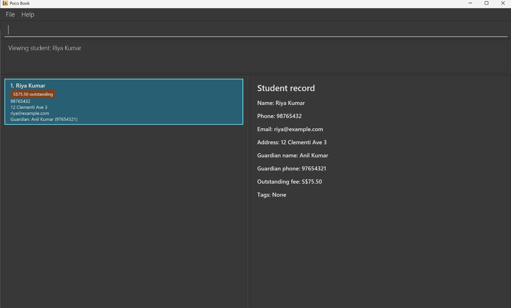

**Poco Book is a desktop application that helps independent tutors manage students, guardian contacts, and outstanding fees.** While it has a GUI, most user interactions happen through a CLI (Command Line Interface), so a tutor who types fast can update a record in a few keystrokes.

**Who it is for:** private tutors who teach many students on their own, keep in touch with each student's parent or guardian, and collect fees themselves.

**What you can do with it:**

* Keep each student's record together with their guardian's name and phone number.
* Find students by name, or by their guardian's name or phone number, so siblings who share a guardian show up together.
* See who owes fees and how much is owed in total, record a full payment, or change what a student owes.
* View a student's complete record, edit it, or delete it after confirming.

**Get started:**

* If you are interested in using Poco Book, head over to the [_Quick Start_ section of the **User Guide**](UserGuide.html#quick-start).
* If you are interested in developing Poco Book, the [**Developer Guide**](DeveloperGuide.html) is a good place to start.
* To meet the team behind Poco Book, see [**About Us**](AboutUs.html).

**Acknowledgements**

* Poco Book is based on [AddressBook-Level3](https://se-education.org/addressbook-level3/) by the [SE-EDU initiative](https://se-education.org).
* Libraries used: [JavaFX](https://openjfx.io/), [Jackson](https://github.com/FasterXML/jackson), [JUnit5](https://github.com/junit-team/junit5)
